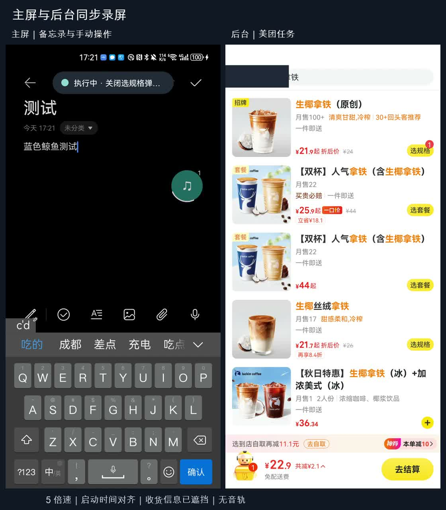

# 隐航 / QuietPilot

English | [中文](README.zh-CN.md) | [User guide](docs/USER_GUIDE.en.md) | [Technical documentation](docs/DEVELOPMENT.md)

QuietPilot is a background assistant for Android phones: it operates real apps to complete tasks while you continue using your phone normally.

The project creates an invisible virtual display on the phone and launches apps such as WeChat, Meituan, and Notes on it. A large language model observes the current interface, decides what to do next, and taps, types, and scrolls until the task is complete or an answer is found. The foreground app on the main display stays in place, so you can keep browsing and typing. The assistant operates the apps and accounts on your own phone, rather than a cloud phone or cloned apps.

For example, you can hold the floating ball and say, “Send this shop to File Transfer Assistant.” The system first reads the main display to identify which shop you mean, then carries out the task in the background. When it reaches a step that requires you, such as payment, login, or a verification code, it pauses and moves the current page intact to the main display. After handling that step, tap “Return to background” to resume the task.

## Demos

[](docs/evidence/coffee-dual-screen/coffee-handoff-53s.mp4)

[53-second dual-screen recording](docs/evidence/coffee-dual-screen/coffee-handoff-53s.mp4): the left side shows the main display, where the user types in Notes; the right side shows the background virtual display. The user asks by voice to order a coconut latte in Meituan, then adds “Make it large and iced” while the task is running. After changing the options, the system stops at the order page for the user to enter delivery details and pay, and moves that page to the main display. The video runs at 5× speed, delivery details are masked, and no payment was made.

[Five demos (02:57)](docs/evidence/demo-path/step6-five-segments.mp4) cover parallel input, skill reuse and recovery, acting on main-screen content, read-only queries, and coffee order amendments. Each segment is labeled as live footage, a freeze frame, or static evidence; unsuccessful portions are also retained. See the [video index](docs/evidence/demo-path/VIDEO.md) for timestamps.

## Key features

**Voice commands grounded in screen content.** Hold the floating ball for about one second, start speaking after the vibration, and release to submit. The main display is read once when you press, to resolve references such as “this” or “this shop.” Speech recognition, task classification, and reference resolution happen in a single multimodal model call.

**Background execution without taking over the main display.** Each task has its own virtual display. Up to two tasks can run concurrently, but tasks using the same app are serialized. If you open an app that a background task is using, the task pauses automatically and resumes when you leave. Tasks also pause when the phone is locked, then observe the interface again and resume after unlocking.

**Handoff and delivery of the original page across displays.** Tasks stop at payment, login, verification-code, and similar boundaries. When you tap “Handle it,” the system moves the original Activity to the main display rather than reopening the app's home page. When you return it to the background, the system verifies the page's identity before continuing. After completion, “View result” likewise transfers the result page intact to the main display.

**Independent result verification.** After the execution model declares completion, a vision model from another provider independently checks the current screenshot and UI tree to determine whether the task is actually complete. For cases such as Notes that allow exact text comparison, the system checks the title and body by resource ID, returns to the list, and reopens the note to check again.

**Read-only queries.** Query tasks can only read: sending, ordering, paying, sharing, and similar actions are blocked. Answers are limited to 60 characters and must include an exact quote from the interface as evidence. The verification model extracts an answer independently before comparing it with the executor's result. If nothing is found, the system says so and reports where it searched.

**Skill learning.** Verified tasks are compiled into parameterized skills, such as “send a given message to a given contact.” Similar tasks later locate targets using semantics and UI element features instead of replaying old coordinates. If the interface differs from expectations, the system attempts up to three recovery steps, then falls back to the model if recovery fails.

**Amendments during execution.** While a task is running, you can speak again to say “Make it large,” “Add ‘see you tomorrow,’” or “Never mind, cancel it.” The request is added to the relevant task and takes effect after the current action finishes. If multiple tasks are active, the system asks which one to amend.

**Execution records.** Each task records its steps, action sources (model / skill / recovery), calls to each model, elapsed time, verification screenshots, and sampled timelines of the foreground app, focus, input method, and clipboard.

## Main contributions beyond upstream

This project is derived from [ShadowAuto](https://github.com/android-notes/ShadowAuto) (Apache-2.0). The underlying virtual display, display-targeted input injection, UiAutomation access, OCR, and H.264 preview capabilities come from upstream, and several open-source implementations of this approach already exist. Building on that foundation, this project primarily adds:

- Moving task pages between virtual and main displays for human handoff and result delivery, with page identity checks and rollback on failure
- Skill learning, reuse, and recovery
- Independent verification using a model from another provider; read-only constraints and safeguards against fabricated query answers
- A voice floating ball, main-screen context capture, and amendments during execution
- Layer-stack mirroring for screenshots (`CaptureMirror`), replacing upstream's temporary output-surface switching to avoid disturbing target apps on physical devices
- Staged recovery when UI elements cannot be read, repeated-action detection, and pause/resume on screen lock
- Yielding to main-screen app conflicts, touch without focus changes, risky-key gating, clipboard snapshot restoration, and quantitative disturbance sampling
- A screenshot/OCR and temporary-focus-borrowing fallback for sending messages in apps such as WeChat that do not expose writable UI elements, with exact checks of drafts and sent messages

See the [derivative changes](docs/DERIVATIVE_CHANGES.md) for individual changes and source locations, and the [technical documentation](docs/DEVELOPMENT.md) for implementation details and tradeoffs.

Only China-based model services are used: DeepSeek for execution, and Alibaba Cloud Model Studio's Qwen for verification and voice understanding. Execution and verification use different providers to improve the independence of verification.

## Physical-device test results

The test device is a Huawei Mate 40 Pro (HarmonyOS 4.2 / API 31). Selected results are listed below; see the [evidence index](docs/evidence/README.md) for the full list.

| Task | Result |
| --- | --- |
| Send a numbered message to WeChat File Transfer Assistant, entirely on the virtual display | `VERIFIED` in 4 steps; text copied from both the draft and sent bubble exactly matched the original |
| Order coffee in Meituan by voice, then add “large and iced” | Options changed correctly; stopped at the order page and transferred the original page to the main display; no payment made |
| Three rounds of continuous Chinese input on the main display alongside a background Amap task requiring text input | All four sampled disturbance counts—foreground app, focus, input method, and clipboard—were 0; typing and candidate suggestions behaved normally |
| Notes skill: first run / reuse with new parameters / deliberately introduced deviation | All three runs `VERIFIED`; logs show `skill → rescue → skill` |
| View a public hotel name on the main display and say “Save it to Notes” | `VERIFIED` in 10 steps; result page delivered to the main display |
| Calculator: “Clear first, then calculate 12×13” | After adding repetition detection: `ANSWERED 156` in 7 steps; previously failed after 25 repeated clearing steps |
| Lock the screen during execution | Paused with the session preserved; the same task reached `ANSWERED` at step 8 after unlocking |
| Repeatedly capture screenshots and then read UI elements on three types of page | 60/60 successful, with no output-surface switches |

Failure samples are also archived, including several early WeChat misjudgments, an uncertain answer to a public opening-hours query, and skill reuse that took longer than the initial run.

## Quick start

You need an Android 10 or later phone with USB debugging enabled, and a computer with ADB installed.

**Install a preview build:** download the controller APK and backend deployment package from [Releases](https://github.com/Cyclopsxu/QuietPilot/releases), then follow the [installation guide](docs/INSTALL.md). The backend process must be started through ADB on a computer and restarted after the phone reboots.

**Build from source** (JDK 17, Android SDK Platform 36, Node.js):

```sh
adb devices -l
./gradlew :android-shell:syncWebLauncherArtifacts
cd web-launcher
npm ci
npm run dev
```

Open the local URL printed in the terminal in a WebUSB-capable browser. Connect your phone, then follow the prompts to upload assets, install the controller, and start the backend. See the [user guide](docs/USER_GUIDE.en.md) for manual ADB deployment and troubleshooting.

**Configure models:** on the controller's configuration page, enter the API key, API base, and model name for each of the three roles, then test the connections.

| Role | Purpose | Service |
| --- | --- | --- |
| executor | UI understanding, action planning, skill compilation | Official DeepSeek API |
| verifier | Result verification, query answer extraction | Alibaba Cloud Model Studio |
| intake | Voice understanding, distinguishing new tasks from amendments | Alibaba Cloud Model Studio (Omni) |

During tasks, UI text, screenshots, recordings, and main-screen context are sent to the configured model services. OCR runs locally on the phone.

## Project structure

```text
android-shell/    Backend: virtual displays, automation loop, verification, skills, RPC
controller-app/   Phone controller: settings, tasks, preview, floating ball, status capsule, history
android-stubs/    Compile-time declarations for hidden system APIs
paddler-ocr/      OCR library and models
web-launcher/     One-click deployment in the browser
scripts/         Regression tests, device probes, recording and reporting tools
docs/            Guides, technical documentation, evidence
```

Common development commands:

```sh
./gradlew :android-shell:assembleDebug :controller-app:assembleDebug
./gradlew :android-shell:lintDebug :controller-app:lintDebug
./scripts/test-interaction-regressions.sh
```

## Known limitations

- The Mate 40 Pro does not provide independent virtual-display focus or a local input method at the system level. The project works around this using touch without focus changes, key gating, and accessibility text writes, and therefore runs in experimental compatibility mode on this device. Text input does not steal focus in apps that expose writable UI elements. WeChat does not expose them, so sending messages requires borrowing focus for a few seconds. The system waits for two seconds of idle main-screen input before borrowing focus and returns it immediately afterward. See the [technical documentation](docs/DEVELOPMENT.md#6-input-and-focus-isolation) for the causes and approaches tried.
- Tasks can only pause while the screen is locked. The original page cannot be restored after the process is terminated or the phone reboots.
- The skill mechanism works end to end, but reuse still often requires recovery or model fallback and has not produced a consistent speed improvement.
- Backend RPC listens on `127.0.0.1:43110` without authentication; other programs on the same phone can connect. API keys are stored in the controller's private storage without using the system keystore.
- Systematic testing has been performed on only one Huawei phone. Compatibility with other devices and apps has not been verified.

## Deployment on everyday users' phones

The backend currently requires a computer running ADB to start. Shizuku with wireless debugging could remove that step while retaining ADB-level privileges, without root. Truly independent focus and a local input method require system-signature-level privileges and cooperation with phone manufacturers; ordinary apps cannot obtain them. In addition, the user agreements of apps such as WeChat, Taobao, and Meituan generally restrict automated operations. Reading main-screen content and sending it to cloud models also requires explicit user authorization under China's Personal Information Protection Law.

## Documentation

- [User guide](docs/USER_GUIDE.en.md): installation, configuration, everyday use, troubleshooting
- [Technical documentation](docs/DEVELOPMENT.md): architecture, implementation details, tradeoffs, and validation
- [Isolation capability boundaries](docs/ISOLATION.md): system capabilities available on the test device
- [Evidence index](docs/evidence/README.md) and [demo notes](docs/DEMO.md)
- [Derivative changes](docs/DERIVATIVE_CHANGES.md)

See the [contribution guide](CONTRIBUTING.md) for development contributions and the [security notes](SECURITY.md) for security issues.

## License

This project retains the [Apache License 2.0](LICENSE). The upstream baseline is ShadowAuto `611e5eb`; original author attribution and notices are preserved in [NOTICE](NOTICE). This project is not endorsed by upstream.
