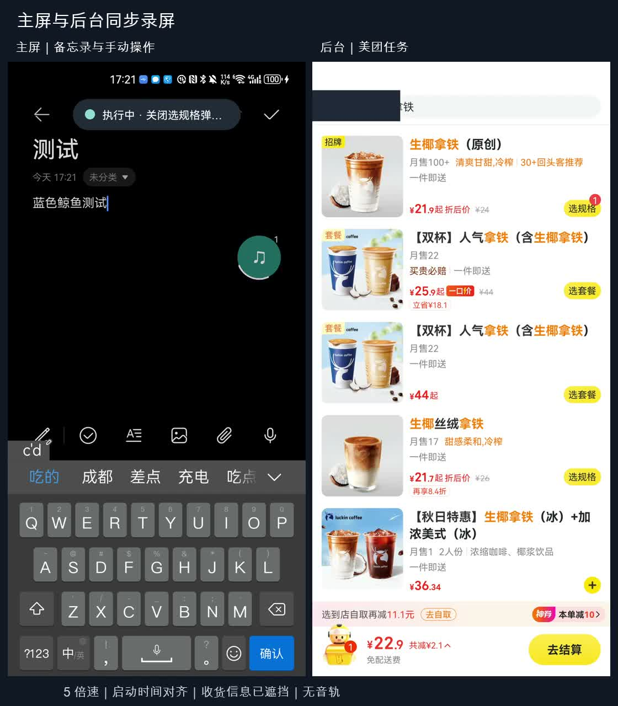

# 隐航 / QuietPilot

[English](README.md) | 中文 | [使用手册](docs/USER_GUIDE.zh-CN.md) | [技术文档](docs/DEVELOPMENT.zh-CN.md)

QuietPilot 是一个运行在 Android 手机上的后台操作助手：用户正常使用手机的同时，它在后台操作真实的 App 完成任务。

本项目在手机上创建一块不可见的虚拟屏，将微信、美团、备忘录等 App 启动在虚拟屏上，由大模型根据实时界面决定下一步操作，并完成点击、输入和滚动，直到任务完成或查到答案。整个过程中主屏前台不切换，用户可以照常浏览和输入。操作对象是用户本机上的 App 和账号，而不是云手机或应用分身。

例如，用户按住悬浮球说「把这家店发给文件传输助手」，系统会先读取当前主屏内容，确定「这家店」指的是哪一家，再在后台执行。遇到支付、登录、验证码等需要本人处理的环节时，任务会暂停，并将当前页面原样移到主屏交给用户；用户处理完成后点击「交回后台」，任务继续执行。

## 演示

[](docs/evidence/coffee-dual-screen/coffee-handoff-53s.mp4)

[53 秒双屏实录](docs/evidence/coffee-dual-screen/coffee-handoff-53s.mp4)：左侧为主屏，用户在备忘录中输入文字；右侧为后台虚拟屏。用户通过语音让系统在美团下单一杯生椰拿铁，执行中追加「改成大杯冰的」。系统修改规格后停在订单页，等待用户填写收货信息并付款，并将该订单页移到主屏。视频为 5 倍速，收货信息已打码，未实际付款。

[五段演示（02:57）](docs/evidence/demo-path/step6-five-segments.mp4)覆盖并行输入、技能复用与救援、边看边办、只读查询和咖啡追加。每段画面均标注了实录、定格或静态证据，未通过的部分同样保留。时间点见[视频索引](docs/evidence/demo-path/VIDEO.md)。

## 主要功能

**语音下达任务，结合屏幕内容理解。** 长按悬浮球约一秒，震动提示后开始录音，松手提交。按下时读取一次主屏内容，用于理解「这个」「这家店」等指代。语音识别、任务分类和指代理解由一次多模态模型调用完成。

**后台执行，不占用主屏。** 每个任务使用独立的虚拟屏，最多两个任务并行，同一 App 不并发执行。用户在主屏打开任务正在使用的 App 时，后台任务自动暂停，用户离开后继续。锁屏时同样暂停，解锁后重新观察界面并继续执行。

**原页面跨屏交接与交付。** 遇到支付、登录、验证码等环节时，任务停在边界处；用户点击「去处理」后，系统将原 Activity 移到主屏，而不是重新打开 App 首页。处理完成交回后台时，系统会核对页面身份再继续。任务完成后点击「去查看」，结果页同样原样移交到主屏。

**完成结果独立验收。** 执行模型声明完成后，由另一家厂商的视觉模型根据当前截图和控件树独立判断是否真正完成。对于备忘录这类可逐字核对的场景，系统按资源 ID 比对标题和正文，并在返回列表后重新打开再次核对。

**只读查询。** 查询任务只允许读取，发送、下单、支付、分享等操作会被拦截。答案不超过 60 字，并须附带界面原文作为依据；验收模型先独立提取答案，再与执行方结果比对。查不到时如实返回，并说明已查找的范围。

**技能学习。** 验收通过的任务会被编译为参数化技能，例如「给某个联系人发送某条消息」。后续同类任务按语义和控件特征定位目标，而不是回放旧坐标。界面与预期不符时最多执行三步救援，仍无法恢复则交回模型处理。

**执行中追加。** 任务执行过程中，用户可以再次通过语音说「改成大杯」「再加一句明天见」「算了不要了」，要求会追加到对应任务，并在当前动作完成后生效。存在多个进行中的任务时，系统会询问追加到哪一个。

**过程记录。** 每个任务记录步骤、动作来源（模型 / 技能 / 救援）、各模型调用次数、耗时、验收截图，以及前台、焦点、输入法、剪贴板的采样时间线。

## 相对上游的主要贡献

本项目基于 [ShadowAuto](https://github.com/android-notes/ShadowAuto)（Apache-2.0）二次开发。虚拟屏、指定屏注入、UiAutomation 控件读取、OCR 和 H.264 预览等底层能力来自上游，且该路线已有多个开源实现。本项目以此为基础，主要新增了以下内容：

- 任务页在虚拟屏与主屏之间移动，用于人工交接和结果交付，并带有页面身份核验和失败回退
- 技能学习、复用和救援
- 使用另一家模型独立验收；查询任务的只读约束和防编造机制
- 语音悬浮球、主屏上下文读取、执行中追加
- 图层栈镜像抓图（`CaptureMirror`），替代上游临时切换输出面的方式，避免在真机上扰动目标 App
- 控件读取失败时的分阶段恢复、重复动作检测、锁屏暂停与续跑
- 主屏冲突让路、无焦点触摸、危险按键门禁、剪贴板快照恢复，以及对干扰情况的量化采样
- 针对微信等不暴露可写控件的 App，采用截图 OCR 与短时焦点借用的兼容方案发送消息，并逐字核对草稿和已发送内容

逐项改动及对应源码位置见[二次开发说明](docs/DERIVATIVE_CHANGES.md)，实现细节与技术取舍见[技术文档](docs/DEVELOPMENT.zh-CN.md)。

模型仅使用国内服务：执行使用 DeepSeek，验收和语音理解使用阿里云百炼的通义千问。执行与验收由不同厂商的模型承担，以提高验收的独立性。

## 真机测试结果

测试设备为华为 Mate 40 Pro（HarmonyOS 4.2 / API 31）。以下为部分结果，完整列表见[证据索引](docs/evidence/README.md)：

| 任务 | 结果 |
| --- | --- |
| 微信给文件传输助手发一条编号消息（全程虚拟屏） | 4 步 `VERIFIED`，草稿和已发气泡复制出来的原文逐字一致 |
| 美团语音点咖啡 + 追加「大杯冰」 | 规格改对，停在订单页，原页面移到主屏交接，未付款 |
| 主屏三轮持续中文输入 + 后台高德输入任务 | 前台、焦点、输入法、剪贴板四项采样均为 0，输入和候选词正常 |
| 备忘录技能：首次 / 换参数复用 / 人为制造偏离 | 三次都 `VERIFIED`，日志里能看到 `skill → rescue → skill` |
| 主屏看到公开酒店名，语音「记到备忘录」 | 10 步 `VERIFIED`，结果页交付到主屏 |
| 计算器「先清除再计算 12×13」 | 加了重复检测后 7 步 `ANSWERED 156`（之前会原地清除 25 步失败） |
| 运行中锁屏 | 暂停并保留现场，解锁后同一任务第 8 步 `ANSWERED` |
| 三类页面反复抓图后读控件 | 60/60 成功，没有切换过输出面 |

失败样本同样归档，包括微信早期的若干次误判、公开营业时间查询答案不确定、技能复用耗时反而增加等。

## 快速开始

需要一台 Android 10 及以上、已开启 USB 调试的手机，以及一台安装了 ADB 的电脑。

**直接装预览版：** 到 [Releases](https://github.com/Cyclopsxu/QuietPilot/releases) 下载控制端 APK 和后台部署包，按[安装说明](docs/INSTALL.md)操作。后台进程需要通过电脑 ADB 启动，手机重启后需重新启动。

**从源码构建**（JDK 17、Android SDK Platform 36、Node.js）：

```sh
adb devices -l
./gradlew :android-shell:syncWebLauncherArtifacts
cd web-launcher
npm ci
npm run dev
```

在支持 WebUSB 的浏览器中打开终端输出的本地地址，连接手机后按提示上传资源、安装控制端并启动后台。手动 ADB 部署和排错见[使用手册](docs/USER_GUIDE.zh-CN.md#3-安装与启动)。

**配置模型：** 在控制端配置页为三个角色分别填写 API Key、API Base 和模型名，并测试连接。

| 角色 | 用途 | 接口 |
| --- | --- | --- |
| executor | 界面理解、操作规划、技能编译 | DeepSeek 官方 |
| verifier | 结果验收、查询答案提取 | 阿里云百炼 |
| intake | 语音理解、判断新任务或追加 | 阿里云百炼（Omni） |

任务过程中，控件文字、截图、录音和主屏上下文会发送给所配置的模型服务；OCR 在手机本地运行。

## 项目结构

```text
android-shell/    后台进程：虚拟屏、自动化循环、验收、技能、RPC
controller-app/   手机控制端：配置、任务页、预览、悬浮球、胶囊、历史
android-stubs/    隐藏系统接口的编译期声明
paddler-ocr/      OCR 库与模型
web-launcher/     浏览器里一键部署
scripts/          回归测试、设备探针、录屏与报告工具
docs/             手册、技术文档、证据
```

常用开发命令：

```sh
./gradlew :android-shell:assembleDebug :controller-app:assembleDebug
./gradlew :android-shell:lintDebug :controller-app:lintDebug
./scripts/test-interaction-regressions.sh
```

## 已知限制

- Mate 40 Pro 在系统层面不提供虚拟屏独立焦点和本地输入法能力，本项目通过无焦点触摸、按键门禁和无障碍文字写入进行规避，因此在该设备上以「兼容实验」模式运行。对于暴露可写控件的 App，输入不会抢占焦点；微信不暴露可写控件，发送消息时需短暂借用焦点数秒，系统会在主屏输入空闲两秒后才借用，并在完成后立即归还。原因与已尝试的方案见[技术文档](docs/DEVELOPMENT.zh-CN.md#6-输入与焦点隔离)。
- 锁屏期间任务只能暂停，无法继续操作；进程被终止或手机重启后，无法恢复原页面。
- 技能机制已跑通，但复用时仍常需救援或交回模型，尚未带来稳定的速度提升。
- 后台 RPC 监听 `127.0.0.1:43110`，尚无鉴权，同一手机上的其他程序也可以连接。API Key 保存在控制端私有存储中，未使用系统密钥库。
- 目前仅在一台华为手机上进行了系统测试，其他机型和 App 的兼容性尚未验证。

## 在普通用户手机上的落地方式

目前后台进程需要通过电脑 ADB 启动。去掉电脑这一步可以使用 Shizuku 配合无线调试，同样是 ADB 级权限，无需 Root。若要获得真正的独立焦点和本地输入法，则需要系统签名级权限，需与手机厂商合作，普通 App 无法申请。此外，微信、淘宝、美团等 App 的用户协议普遍限制自动化操作；读取主屏内容并发送至云端模型，也需依照《个人信息保护法》取得用户的明确授权。

## 文档

- [使用手册](docs/USER_GUIDE.zh-CN.md)：安装、配置、日常使用、排错
- [技术文档](docs/DEVELOPMENT.zh-CN.md)：架构、实现细节、技术取舍和验证情况
- [隔离能力边界](docs/ISOLATION.md)：测试设备上各项系统能力的可用情况
- [证据索引](docs/evidence/README.md)和[演示说明](docs/DEMO.md)
- [二次开发说明](docs/DERIVATIVE_CHANGES.md)

参与开发见[贡献指南](CONTRIBUTING.md)，安全问题见[安全说明](SECURITY.md)。

## 许可证

本项目沿用 [Apache License 2.0](LICENSE)。上游基线为 ShadowAuto `611e5eb`，原作者署名与声明保留在 [NOTICE](NOTICE)。本项目与上游不存在背书关系。
