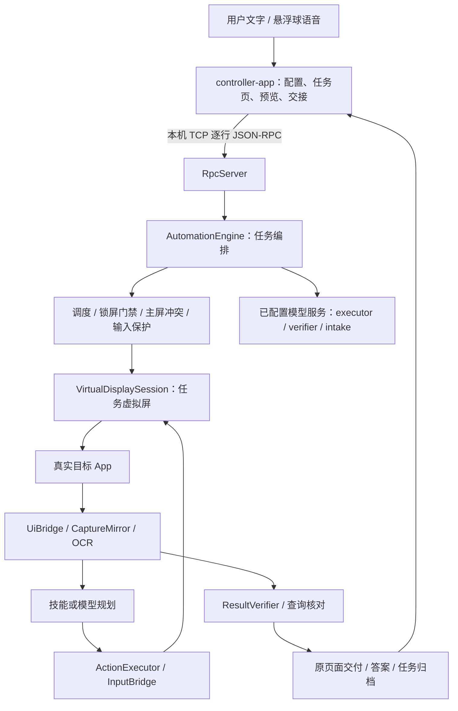

# 开发与技术方案

维护日期：2026-10-26。代码基线为`f97c8ba`及本轮微信视觉兼容增量。Step6原有Android验证基线为`cedab19`，锁屏保护单独见[锁屏报告](evidence/screen-lock/report.md)；微信实现、正式发送、焦点调查与本次整理范围统一见第12节。

本文是本分支的开发维护基线，回答“目前实现了什么、如何实现、修改时要保持哪些约束、哪些结论尚未验证”。面向接手开发、排查问题和评审实现的人。安装、权限与日常操作见[中文使用手册](USER_GUIDE.zh-CN.md)；演示素材见[视频索引](evidence/demo-path/VIDEO.md)；阶段验收明细见[Step6 状态](STEP6-STATUS.md)。使用手册中的旧轮次记录按当时范围理解，当前阶段状态以本文和 Step6 状态为准。

## 1. 实现范围与验证状态

系统是同一台 Android 手机上的自动化原型：控制端接收任务，shell 进程在虚拟屏操作真实 App，完成后返回答案或将原页面交给用户。上游基线 `611e5eb0e1c94befda3c17c97438912dfd30e8a8` 提供 shell/app_process、虚拟屏、UI/OCR、输入与预览底座；本分支扩展验收、交接、技能、语音、保护与归档，具体归属见[二次开发说明](DERIVATIVE_CHANGES.md)。

下表的“实现”表示存在可执行代码；“验证”限定在已归档样本，不代表通用适配。

| 能力 | 当前实现 | 已验证的范围与缺口 |
| --- | --- | --- |
| 后台任务与预览 | 每任务虚拟屏、目标 App 启动、UI/OCR、输入、H.264 预览 | Mate 40 Pro 有实际任务记录；微信显示规格已修复，节点不可读时可回退截图/OCR；文件传输助手正式后台发送有单次VERIFIED，仍借用全局焦点 |
| 调度与主屏优先 | 最多两个活动槽位；同 App 串行；与主屏同 App 冲突时等待/暂停 | 具备保护逻辑；跨设备和长期并发稳定性未覆盖 |
| 锁屏暂停与解锁续跑 | 熄屏/Keyguard 门禁；新任务排队、运行中暂停保留；解锁重新观察；不消耗锁屏期间的冲突超时预算 | Mate 40 Pro 同一计算器任务第 5 步暂停，解锁后第 8 步 ANSWERED 579；仅证明解锁续跑，不能锁屏持续操作或跨进程恢复 |
| 输入与焦点保护 | 显示屏定向输入、无焦点触摸、危险键门禁、节点归属检查、剪贴板保护 | 三轮中文输入采样四项均 0、机主反馈正常；原生独立焦点和本地 IME 能力不足，不认证全程隔离 |
| 办事验收与交付 | 独立验收、文档完整性核对、原任务转主屏、转移失败回退 | 备忘录同页交接有证据；不能用启动另一个页面替代原页面交付 |
| 查询 | 只读动作约束、短答案、原文引文、独立提取与比较 | 计算器和公共地址有成功样本；公开时间查询另有不确定/截断答案，地址复测亦有失败 |
| 重复动作退出 | 有限窗口检测，第一次反馈，第二次进入独立验收 | 7 步 ANSWERED 156；另一次 16 步重复验收失败，均保留 |
| 技能学习与复用 | 参数化编译、语义定位、页面指纹、有限救援、模型回退、状态管理 | 备忘录探索/复用/救援三段均 VERIFIED；调用 10→8→14，耗时约 27.7→49.4→63.3 秒，未证明提速 |
| 语音与执行中追加 | 悬浮球录音、intake 理解、任务路由、modify/add/cancel 队列 | 真语音修改大杯；另一次大杯冰美式到支付前 WAITING_USER 并交接，机主确认规格；成功流程连续双屏录像缺失 |
| 主屏上下文 | 录音前采集、密码节点遮蔽、短时上下文、开关与丢弃 | 公开酒店名→备忘录成功；来源未显示完整地址，未验证地址传递或微信发送 |
| 历史、指标与证据 | 步骤来源、角色调用数、耗时、截图、隔离诊断、原始干扰采样、任务归档 | 有脱敏仓库证据；缺失/不可用观测不能计作零 |
| 录制与演示 | READY 识别、双路 scrcpy、虚拟屏销毁收尾、可重建剪辑 | 已有 02:57 五段证据版；含失败、静态证据和归档说明，非一次连续全成功录像 |

当前没有实现：RPC 应用级鉴权、免电脑 Shizuku 启动、云账号与计费、跨重启恢复原 UI 会话、通用设备隔离认证。微信文件传输助手在本机正式虚拟屏任务单次验收通过，使用短时焦点借用与明确编号原文参数，尚未证明通用发送稳定性。私人订单查询由机主选择跳过，不属于已验收功能。

## 2. 系统分层与部署边界



| 模块 | 职责与入口 |
| --- | --- |
| `android-shell` | shell 权限执行进程；[Main](../android-shell/src/main/java/com/silentauto/shell/Main.java) 启动，[RpcServer](../android-shell/src/main/java/com/silentauto/shell/RpcServer.java) 分发，[AutomationEngine](../android-shell/src/main/java/com/silentauto/shell/AutomationEngine.java) 编排 |
| `controller-app` | 用户界面与连接；[MainActivity](../controller-app/src/main/java/com/silentauto/controller/MainActivity.java)、[AutomationTaskView](../controller-app/src/main/java/com/silentauto/controller/AutomationTaskView.java)、[RpcClient](../controller-app/src/main/java/com/silentauto/controller/RpcClient.java) |
| `android-stubs` | 编译期系统接口声明；不是运行时系统实现，也不提供额外权限 |
| `paddler-ocr` | OCR 库、模型与字典；运行资产需部署到设备 |
| `web-launcher` | 浏览器部署入口；不承担手机上的自动化循环 |
| `scripts` | 主机回归、设备探针、采样汇总与录像整理 |

shell APK 通过 ADB / `app_process` 作为 shell 进程运行。普通控制端 APK 的安装不能替代后台进程启动。代码使用系统服务与隐藏接口，API 声明存在不等于某个厂商系统允许调用。两 Android 模块当前 `minSdk=29`、`compileSdk/targetSdk=36`，Java 源码级别 17；最低 SDK 不等于完成该版本设备适配。

## 3. 任务编排与状态契约

一次任务主要经过：解析目标/角色配置 → 应用选择与技能匹配 → 调度准入 → 创建虚拟屏 → 观察与执行循环 → 验收或人工等待 → 交付/清理 → 归档。具体顺序与分支以 `AutomationEngine` 为准。

[TaskScheduler](../android-shell/src/main/java/com/silentauto/shell/ext/guard/TaskScheduler.java) 同步维护活动槽位，最多两个、同 App 不重入；`force` 不突破两个槽位和同 App 串行约束。[MainAppConflictGuard](../android-shell/src/main/java/com/silentauto/shell/ext/guard/MainAppConflictGuard.java) 与前台观测处理主屏冲突。资源释放要覆盖成功、异常、停止、等待超时与转移后的收尾。

### 3.1 锁屏保护与续跑

[DeviceLockState](../android-shell/src/main/java/com/silentauto/shell/DeviceLockState.java) 通过 `!PowerManager.isInteractive() || KeyguardManager.isKeyguardLocked()` 判断阻塞。熄屏与亮屏但 Keyguard 未解除都不能执行自动输入；不自动唤醒或绕过系统锁屏。

- **准入：**`awaitAdmission` 约每 2 秒检查一次，锁屏期间保持 `QUEUED`，不申请新调度槽位、不启动目标 App；`forceStart` 也不绕过锁屏门禁。应用选择/技能匹配等准入前准备仍可能调用模型，不能宣称锁屏排队零调用。
- **运行：**`MainAppConflictGuard` 约每秒观察；首次发现锁屏时增加 epoch、设置恢复标记并转 `PAUSED`，保留任务与虚拟屏。`inputAllowed()` 另外直接检查锁屏状态，输入门禁不依赖下一次定时观察。重复观察同一次锁屏不会反复增加 epoch。
- **超时：**锁屏期间持续刷新 `pausedAt`，解除锁屏时也重置计时起点；若解锁后主屏仍使用同一 App，则继续暂停并重新计算十分钟冲突超时。当前实现不是保留锁屏前已消耗的冲突预算。
- **续跑：**解锁且主屏冲突解除后返回 `RUNNING`，由 `recoverAfterConflict` 重新观察。循环内遇到锁屏或冲突 epoch 变化相关异常，等待后丢弃本轮规划再重试；被打断输入不消耗执行步数。首次启动 App 因锁屏失败也等待后重试。用户停止/线程中断仍正常退出，不归入自动重试。
- **边界：**任务和虚拟屏资源保留不代表厂商 App 页面永远不变；没有进程强杀、重启或 App 自行销毁页面后的原会话恢复。锁屏分支只将 `RUNNING` / `PAUSED` 转换，不能外推为 `WAITING_USER` 等所有等待状态的超时均被挂起。

Mate 40 Pro（API 31）锁屏会用 SystemUI 时钟覆盖虚拟屏，目标 Activity 进入 STOPPED；局部唤醒锁不能阻止此行为。独立显示组创建因缺少 `ADD_TRUSTED_DISPLAY` 被拒，`ALWAYS_UNLOCKED` 标志不存在；这些探针未改变正式虚拟屏 flags。因此方案采用解锁后续跑，不能宣称锁屏持续操作。

2026-10-25 的已有实机记录：同一计算器任务在 display 158 第 5 步锁屏暂停，68 秒检查仍保持步骤、display 和 executor 8 次；机主解锁后第 8 步 `ANSWERED` 579、`finalized=true`，executor 12 次、verifier 1 次，总耗时 642,079ms（含等待）。另一个锁屏新任务保持第 0 步排队后取消。详见[锁屏验证记录](evidence/screen-lock/report.md)。本次文档同步未重新执行这些设备测试。

### 3.2 对外状态与归档契约

[TaskProgress](../android-shell/src/main/java/com/silentauto/shell/ext/TaskProgress.java) 维护对外状态与指标；[TaskStatus](../android-shell/src/main/java/com/silentauto/shell/ext/TaskStatus.java) 定义终态。

| 状态 | 转换约束 |
| --- | --- |
| `QUEUED` | 准入后进入 `RUNNING` |
| `RUNNING` | 可进入 `PAUSED`、`WAITING_USER`，或 `VERIFIED` / `ANSWERED` / `NOT_FOUND` |
| `PAUSED` | 解除保护后回到 `RUNNING` |
| `WAITING_USER` | 本人完成后回 `RUNNING`，或 `HANDOFF_TIMEOUT` |
| 取消/失败 | 非终态允许进入 `CANCELLED` / `FAILED`；终态不再普通转换 |

`WAITING_USER` 不是办事成功；支付前暂停可属于正确边界处理，但不能写成已付款或整单完成。`VERIFIED` 是办事验收终态，`ANSWERED` 是查询答案终态。验收还应读取 `uncertain`、引文与证据，不单看状态名。

`status` 到达终态与归档完成不是同一时刻。读取最终截图、指标和技能比较时应等待 `finalized=true`。接口集成同时保留 `taskId`、`displayId`、`originalGoal`、有效 `goal`、`amendments`、`transferState`、`resultReady`、`protectedScreen`，不能从单一字段推断页面仍可用。

## 4. 观察、规划与动作执行

每轮先等待锁屏/主屏冲突解除，再检查后台安全与追加目标，之后读取当前 display 的 UI。根节点不可用、遍历不完整与真实叶节点分开判断；[UiRecoveryBudget](../android-shell/src/main/java/com/silentauto/shell/ext/guard/UiRecoveryBudget.java) 限制等待、无障碍重连及查询重启，耗尽后转人工。查询重启仅在确认目标 App 仍在虚拟屏且未位于主屏时尝试。

动作优先取自技能和扩展策略，不能生成时由 executor 规划；最终由 [ActionExecutor](../android-shell/src/main/java/com/silentauto/shell/ext/ActionExecutor.java)、`InputBridge` 等落实。`StepListener` 贯穿观察和动作记录，动作来源用于区分 model、skill、rescue、query_recovery 等路径。

规划期间记录 UI 连接代际、冲突 epoch 与目标版本。执行前发生变化则丢弃旧规划、重新观察；[ObservedTarget](../android-shell/src/main/java/com/silentauto/shell/ext/guard/ObservedTarget.java) 和 [NodeWritePolicy](../android-shell/src/main/java/com/silentauto/shell/ext/guard/NodeWritePolicy.java) 校验当前目标及窗口/包名归属。节点索引和坐标是当次观察的结果，不能跨重连或页面变化直接复用。

[LoopDetector](../android-shell/src/main/java/com/silentauto/shell/ext/guard/LoopDetector.java) 保留最近 6 次观察，检测相同屏幕/动作三次或屏幕 ABAB 交替。第一次向 executor 提供反馈；再次触发则不继续 executor 规划，直接独立验收/提取答案，无可核验证据则失败。技能回放不参与重复计数；目标追加后清空检测窗口。这是有限模式检测，不能识别所有业务循环。

## 5. 显示屏、抓图与输入隔离方案

[VirtualDisplaySession](../android-shell/src/main/java/com/silentauto/shell/VirtualDisplaySession.java) 负责屏幕、输出面及隔离能力诊断。优先尝试系统支持的独立焦点/禁止抢焦点等 flags，并记录候选、拒绝原因与最终 flags；兼容回退必须保持可见诊断。

截图优先采用 [CaptureMirror](../android-shell/src/main/java/com/silentauto/shell/CaptureMirror.java) 的独立图层栈镜像与持续图像排空，避免为抓图切换原视频输出面，减少“抓图后控件不可读”的触发因素。隐藏接口不可用时仍可能回退旧路径；应分别报告 capture mode、misses、surfaceSwitches，不把回退当作相同保证。

输入保护分多层：

- 显式 displayId、无焦点触摸及 `BackgroundKeyPolicy` 限制可能影响主屏的按键。
- 当前节点与目标包名检查；搜索提交由 `SubmitTargetPolicy` 排除语音/相机图标等误目标。
- `ClipboardGuard` 处理需要剪贴板的输入与恢复；剪贴板恢复不等于从未发生瞬态变化。
- 主屏同 App 冲突优先让用户操作；不能靠强行切回后台掩盖冲突。

[DisturbanceMonitor](../android-shell/src/main/java/com/silentauto/shell/ext/metrics/DisturbanceMonitor.java) 约 500ms 采样焦点、IME、前台和剪贴板摘要等，原始时间线有上限，未知值、间隔和截断单独报告。Mate 40 Pro 当前 `behaviorValidated=false`，三轮正常反馈与零采样不改变这个结论。能力与实验模式说明见 [ISOLATION](ISOLATION.md)。

## 6. 完成验收、查询与人工交接

executor 负责规划；[ResultVerifier](../android-shell/src/main/java/com/silentauto/shell/ext/verify/ResultVerifier.java) 用当前证据独立判断结果与人工边界。模型角色通过 [ModelConfig](../android-shell/src/main/java/com/silentauto/shell/ext/config/ModelConfig.java) 分开配置。备忘录另有 [DocumentProof](../android-shell/src/main/java/com/silentauto/shell/ext/verify/DocumentProof.java) 的完整正文/保存与重开核对路径，因此某些 VERIFIED 样本 verifier 调用为 0，不能称为“另一模型视觉验收”。

查询使用 [ReadOnlyGuard](../android-shell/src/main/java/com/silentauto/shell/ext/guard/ReadOnlyGuard.java) 限制交易、发送等写动作；候选答案与连续原文引文由 [AnswerVerifier](../android-shell/src/main/java/com/silentauto/shell/ext/query/AnswerVerifier.java) 及独立证据提取核对。答案上限 60 个 Unicode 码点。`NOT_FOUND` 只表示本次搜索范围；只读门禁不是对任意页面的形式化安全证明。

[HandoffManager](../android-shell/src/main/java/com/silentauto/shell/ext/handoff/HandoffManager.java) 处理登录、验证码、支付等本人边界；[ManualTaskTransfer](../android-shell/src/main/java/com/silentauto/shell/ext/handoff/ManualTaskTransfer.java) 与 [TaskDisplayTransfer](../android-shell/src/main/java/com/silentauto/shell/ext/handoff/TaskDisplayTransfer.java) 移动原任务；[PageIdentity](../android-shell/src/main/java/com/silentauto/shell/ext/handoff/PageIdentity.java) 校验页面身份；[ResultRetention](../android-shell/src/main/java/com/silentauto/shell/ext/handoff/ResultRetention.java) 保留可交付结果。

维护时要检查转移后的实际 display/root task、原页面身份及回退结果，再决定是否释放虚拟屏。响应中的 `moved` 与 `previewAvailable` 表示不同事实；不能提前关闭仍供预览/重试的资源。进程强杀后无法恢复相同活页面。

## 7. 技能学习、复用与救援

[TrajectoryRecorder](../android-shell/src/main/java/com/silentauto/shell/ext/skill/TrajectoryRecorder.java) 记录动作及前后页面；[SkillCompiler](../android-shell/src/main/java/com/silentauto/shell/ext/skill/SkillCompiler.java) 只将符合条件的成功轨迹编译为参数化技能；含人工交接、失败或目标追加等轨迹不作为普通成功学习样本。

[SkillMatcher](../android-shell/src/main/java/com/silentauto/shell/ext/skill/SkillMatcher.java) 选择 active、类型相符且覆盖目标的技能，并校验本次参数。[SkillRunner](../android-shell/src/main/java/com/silentauto/shell/ext/skill/SkillRunner.java) 用当前语义目标定位；旧 bounds 仅作参考，不是坐标回放。[ScreenFingerprint](../android-shell/src/main/java/com/silentauto/shell/ext/skill/ScreenFingerprint.java) 排除时钟/相对时间、隐藏节点和列表条目等易变信息，以稳定控件描述页面。

偏离时最多 3 个救援动作，救援用于恢复流程，不能直接跳过最终验收。仍不能继续则弃用本次技能，回到模型；连续弃用 3 次将技能标为 suspect。[SkillStore](../android-shell/src/main/java/com/silentauto/shell/ext/skill/SkillStore.java) 管理启停、删除、统计与落盘；用户禁用不应被普通学习覆盖。

查询技能保存重新查找的方法，每次重新读答案，不复用旧答案。技能表现同时比较成功率、调用数、耗时和救援/回退比例；当前三个备忘录样本只证明路径可运行。[实测报告](evidence/skills/report.md) 中的脱敏技能副本不是可导入资产。

## 8. 语音、主屏上下文与追加

控制端 [FloatingBallService](../controller-app/src/main/java/com/silentauto/controller/ext/overlay/FloatingBallService.java) / `WavRecorder` 实现按住录音、就绪震动、松手提交和取消。shell [VoiceIntake](../android-shell/src/main/java/com/silentauto/shell/ext/voice/VoiceIntake.java) 理解语音，[VoiceRouting](../android-shell/src/main/java/com/silentauto/shell/ext/voice/VoiceRouting.java) 区分新任务与追加；有多个可能目标时要求选择。

[ScreenContextReader](../android-shell/src/main/java/com/silentauto/shell/ext/context/ScreenContextReader.java) 在录音前读取主屏上下文，[ScreenPrivacy](../controller-app/src/main/java/com/silentauto/controller/ext/context/ScreenPrivacy.java) 参与隐私处理。上下文有开关、丢弃接口与 120 秒有效期。密码节点遮蔽和短时保留不能替代读取页面及发送模型的授权；页面包含的信息可能比用户口述更多。

[AmendmentQueue](../android-shell/src/main/java/com/silentauto/shell/ext/amend/AmendmentQueue.java) 保留原目标、modify/add/cancel 记录和有效目标；循环在受控点消费，目标版本变化后丢弃旧规划并退出旧技能。测试必须区分真实麦克风/intake 路径与直接 RPC 注入，后者不能证明语音链路。

## 9. RPC、配置与数据存储

默认 `127.0.0.1:43110`，TCP 逐行 JSON-RPC。控制端必须按请求 id 关联响应，并处理异步状态/日志/视频事件；不是 HTTP 服务。状态事件使用 `event="status"`，任务 `type` 保留 action/query。方法和参数以 `RpcServer` 分发为准，完整操作示例在使用手册。

| 接口族 | 典型方法 |
| --- | --- |
| 健康与任务 | `ping`、`status`、`startTask`、`stopTask`、`listTasks`、`getTask` |
| 语音/上下文/追加 | `submitVoiceTask`、`confirmTask`、`resolveVoice`、`captureContext`、`discardContext`、`amendTask` |
| 人工与结果交接 | `takeManualOnMain`、`resumeTask`、`takeResultOnMain`、`injectTouch` |
| 历史与技能 | `listHistory`、`listSkills`、`setSkillStatus`、`deleteSkill` |

`RpcConnection` 防回环自连接；`RpcClient` 防止旧读线程清理新 socket，修改请求写入失败不自动重放。`OverlayRpc` 处理悬浮层重连和请求关联。服务端客户端发送队列容量 64，慢客户端断开，避免全体任务被阻塞。

控制端三角色配置保存在私有 `ai_config` SharedPreferences，未实现密钥保险库。shell 的技能、轨迹、历史、截图和上下文位于 `/data/local/tmp/shadowauto/` 下对应子目录，属于 shell 可访问数据，控制端重装不代表清空这些数据。模型请求可能包含控件文本、截图、音频或上下文，按角色和实际路径发送。

当前 RPC 无应用级鉴权；回环监听不隔离同机其他进程。后续方案是随机 token，并同步处理控制端传递、部署、轮换及旧连接行为，尚未实现。[ModelConnectionProbe](../controller-app/src/main/java/com/silentauto/controller/ext/config/ModelConnectionProbe.java) 已显示服务返回的 model；现有三角色实测返回别名，不能据此证明精确权重快照。

## 10. 开发验证与证据维护

在仓库根目录构建与检查：

```sh
./gradlew :android-shell:assembleDebug :controller-app:assembleDebug :android-shell:lintDebug :controller-app:lintDebug
./scripts/test-interaction-regressions.sh
```

先完成 Android 构建，回归脚本复用已解析的 Gson 缓存与 debug classes。目前包含九组 Java 检查：连接、UI 恢复、交互保护、任务转移、查询、RPC 输出、锁屏保护、视觉输入、重复检测；另外运行 isolation-report JS 测试与录制脚本 Python 测试。主机检查不能证明设备接受隐藏 API。设备探针、真实模型任务和中文输入并行测试需要单独进行。Web 修改在 `web-launcher` 执行 `npm run build`；纯文档修改只需检查链接和内容一致性。

Step6 的 Android 构建、两模块 Lint 和当时回归通过，见 [build-checks.json](evidence/build-checks.json)；该 JSON 不覆盖新增锁屏代码。锁屏增量的[验证报告](evidence/screen-lock/report.md)另记两模块构建/Lint、最终补充后的 shell 构建/Lint及完整回归通过。[ScreenLockRegression](../scripts/tests/ScreenLockRegression.java) 覆盖输入即时拦截、模拟一小时锁屏保留、解锁恢复、真实同 App 冲突超时和锁屏取消。模拟一小时不代表一小时真机耐久测试。本次仅核对代码、报告与文档链接，未重跑构建或设备验收。

[证据索引](evidence/README.md) 组织脱敏报告与样本，[provenance.json](evidence/provenance.json) 记录来源和公开产物哈希。原始资料留在仓库同级工作区 `../docs/validation/`，不默认进入 Git；原片可能包含个人信息。公开前检查截图/视频画面与 JSON，保留失败样本、未知指标与采样缺口，不能补造缺失录像。

录像工具为 `scripts/record-demo.sh`；成片由 `scripts/build-step6-demo.py`、编辑计划和来源原片重建，具体命令见[视频索引](evidence/demo-path/VIDEO.md)。`scripts/verify-step6-video.m` 做逐帧 OCR 规则检查，另配解码和画面抽查；无规则命中不能当作完整隐私保证。

## 11. 后续工作与变更记录规则

| 优先级 | 工作 | 完成判据 |
| --- | --- | --- |
| P1 | 微信发送稳定性与更多入口 | 文件传输助手正式后台任务已有单次通过；继续覆盖普通任务入口、更多布局和重复运行，保留焦点/设备限制 |
| P1 | 完整店铺上下文 | 公开详情页同时包含店名和完整地址，来源→intake→目标正文逐项核对 |
| P1 | 咖啡成功流程连续双屏录像 | 同一任务覆盖真语音追加、规格确认、支付前暂停与原页面交付，无付款操作 |
| P1 | 隔离复验 | 修正后中文拼音候选词与滚动三轮重跑，联合原始日志、双屏录像和机主反馈；仍缺系统能力则保留实验标记 |
| P2 | RPC token 鉴权 | 未授权请求被拒，控制端正常重连，部署与轮换路径可回归 |
| P2 | 技能稳定性与性能 | 扩大同类任务样本，降低救援/模型回退；同时报告耗时与调用数 |
| P2 | 锁屏保护扩展验收 | 覆盖模型请求中途锁屏、解锁后同 App 冲突、长时待机、人工等待状态与其他设备；保留厂商页面销毁限制 |
| P2 | 跨设备与长期稳定性 | 明确设备/系统矩阵，覆盖长时间任务、退出、重连、资源回收 |

修改运行代码时，同步更新本文受影响的方案与状态；接口/状态字段变化同时更新控制端和回归；新增实测写日期、设备、代码基线、原始结果及限制，再链接到证据。README 只维护面向用户的入口、配置和操作，阶段细节进入状态/证据文档。功能计划在验收前始终标记为待实现或待验证。

| 日期 | 开发文档变更 |
| --- | --- |
| 2026-10-25 | 对照工作区锁屏增量补齐能力表、状态/输入/异常恢复方案、实际计时语义、八组回归清单及真机范围；区分 Step6 与锁屏验证基线 |
| 2026-10-25 | 建立本文件，整理截至 Step6 的实现、模块边界、技术约束、验证状态和后续判据；未改运行代码 |
| 2026-10-26 | README 改为标准项目首页，详细操作手册迁至 `USER_GUIDE.zh-CN.md` / `USER_GUIDE.en.md`，开发文档继续维护技术方案与验证状态 |
| 2026-10-26 | 项目工作名改为隐航 QuietPilot；保留包名、RPC 与设备数据兼容；生成部署资源不再纳入当前源码树，补齐贡献/安全/发布说明 |
| 2026-10-26 | 准备 v0.1.0-alpha.1（versionCode 2）release 构建，以开发证书签名，提供 APK、ARM64 后台/OCR ZIP、安装与限制说明；打包方法见 `scripts/package-release.py` |

| 2026-10-26 | 保留微信视觉兼容方案，合并六份阶段说明到第12节，补齐原文参数/发送后目标变更保护与回归；证据附件保留 |

## 12. 微信视觉兼容与焦点边界

本节合并2026-10-26的启动诊断、截图/OCR对照、正式后台发送、焦点根因与不换手机的输入绕行调查。当前保留兼容方案，不把它提升为原生独立焦点；原始JSON、日志和完整截图保留为证据附件，独立阶段说明已归并到本文。设备为Huawei Mate40Pro NOH-AN01 / HarmonyOS4.2 / SDK31，微信8.0.79 (3200)。

### 12.1 能力与使用约束

| 路径 | 当前结果 | 使用边界 |
| --- | --- | --- |
| 可写无障碍节点直接设置文本 | 标准EditText样本成功写入中文，目标windowFocus=false，主屏焦点保持0 | 要求目标App暴露可写节点，不代表任意App或持续拼音输入并发已认证 |
| 微信截图/OCR＋可见菜单粘贴 | 正式虚拟屏任务单次VERIFIED | 输入、草稿复制与已发气泡复制短时借用全局焦点，finally恢复焦点及剪贴板；不能保证主屏持续打字不中断 |
| 指定displayId的原生按键/粘贴键 | 能写入测试框，但同时转移全局焦点 | 原生后台按键门禁保持关闭，不能用这种方式宣称无打扰 |
| 本机微信真正无抢焦点输入 | 未找到当前权限下可交付的通用路径 | 微信无障碍节点不可写；系统级改造未实施 |

严格隔离检查仍为默认门禁；不足时阻止后台，只有明确选择的`--allow-unverified-isolation=true`兼容实验才放行。`experimental_unverified`、`behaviorValidated=false`和原始焦点变化记录保留。归还焦点不等于从未抢过，也不保证恢复主屏输入法的 composing/candidate 状态。锁屏期间仍暂停任务，解锁后重新观察；本轮不是锁屏持续输入验证。

### 12.2 实现与接口合同

- **显示规格与根节点：**`DisplaySpec.current`优先从同一逻辑显示配置的`getRealMetrics`读取尺寸和密度，再回退wm。修复本机1152×2376与物理560 dpi混用，实际逻辑密度为480。`UiBridge`排除不可见、零尺寸、无子节点、无有效内容的占位根；真实叶节点不受误伤，系统/IME窗口不能掩盖空应用根。记录`placeholderRootCount`并执行有界清缓存/重连。
- **正式视觉回退：**重连后应用根仍不可读时，`AutomationEngine`在目标仍属任务虚拟屏、手机未锁定等条件下，使用同一帧截图及本地PaddleOCR生成视觉观察；步骤来源为`vision_ocr`，规划使用verifier配置的视觉模型，调用单独记录`visual_planner`。控制端总调用数包含该角色。视觉步骤不编译为依赖语义节点的技能。
- **定位与菜单：**唯一、高置信度OCR文字优先于模型估计坐标；0–1000归一化坐标经换算与边界校验后使用。文字点击执行前重新截图定位，以应对会话列表重排。菜单可有限重观察；低置信度的小字候选可局部2倍放大OCR，仍须精确标签、置信度≥0.85且唯一，失败保存原图并停止，不猜坐标或降级原生快捷键。
- **焦点事务：**`InputFocusTransaction`串行化兼容输入。开始要求主屏焦点0及可识别的当前主屏任务；正常触摸取得目标虚拟屏焦点，检查任务归属、锁屏/冲突与10秒期限，再通过可见菜单全选/粘贴。成功、失败、取消都恢复用户当前主屏任务焦点，保留线程中断，剪贴板经原始ClipData快照恢复。10秒是受控点的期限检查，不是对底层系统调用阻塞的硬实时上限。
- **原文绑定：**`startTask`可同时提供`exactMessage`、`exactRecipient`，两者必须逐字出现在授权goal中；正文必须只有一个至少10位的数字编号。缺一项、原文不在目标中、编号缺失或歧义会提前拒绝。不传这两个字段则保持普通视觉规划/独立发送前验收，不自动获得本轮确定性正文断言。发送前目标变化会失效旧绑定并重新观察；发送后目标变化则停止验收，不能把旧消息当成新目标完成，也不能重发。
- **发送前门禁：**显式绑定路径在正确标题下写入原文，通过“全选→复制”逐字比较完整草稿；新OCR须再次确认标题，并且完整编号只能出现一次、置信度≥0.9且位于底部15%草稿区。该保守几何范围只适用于已测试的短消息布局，不是任意输入框的通用判据。
- **发送后验收：**发送尝试在执行点击前锁存；后续只验收，禁止重复输入/重发。必须仍在原虚拟屏、未转主屏且焦点已恢复0。对唯一编号气泡执行“复制”，逐字比较原文，设置`draftCopyVerified`/`messageCopyVerified`。独立视觉验收继续核对会话标题、对应编号的右侧已发气泡及无失败/持续发送指示；不要求微信不存在的已读对勾，不宣称跨设备接收或已读。
- **证据与指标：**视觉验收可查看原图顶部7%标题与编号中心上下各10%高度全宽区域的拼接检查视图，明确标注坐标映射、像素不改写；最终证据仍保存完整原图。`DisturbanceMonitor`只将明确焦点借用区间归因于输入事务，原始焦点计数不抹零，超出事务的焦点异常仍触发保护。新增`inputFocusTransactions`，`zeroDisturbanceVerified`仍为false。

代码入口：[AutomationEngine](../android-shell/src/main/java/com/silentauto/shell/AutomationEngine.java)、[InputFocusTransaction](../android-shell/src/main/java/com/silentauto/shell/ext/guard/InputFocusTransaction.java)、[VisualActionPolicy](../android-shell/src/main/java/com/silentauto/shell/ext/guard/VisualActionPolicy.java)、[ResultVerifier](../android-shell/src/main/java/com/silentauto/shell/ext/verify/ResultVerifier.java)。

### 12.3 本机系统限制与源码依据

| 检查 | 本机结果 | 含义 |
| --- | --- | --- |
| `config_perDisplayFocusEnabled`资源 | false | 系统未启用全局每屏独立焦点，不是普通App设置 |
| `OWN_FOCUS` / `STEAL_TOP_FOCUS_DISABLED` | 均为NoSuchFieldException | 本机框架缺失单屏独立/不抢顶层焦点标志，反射或猜常量不能补齐实现 |
| shell UID2000权限 | `ADD_TRUSTED_DISPLAY=-1`；`INTERNAL_SYSTEM_WINDOW=0`、`INJECT_EVENTS=0` | 拥有注入权限不等于拥有受信任显示屏权限 |
| 创建TRUSTED虚拟屏 | SecurityException，要求ADD_TRUSTED_DISPLAY | 权限拒绝得到探针确认 |
| 临时普通屏186设置LOCAL IME | SecurityException，原因是untrusted virtual display；前后策略均为1（fallback） | 本地输入法显示策略被系统信任检查拒绝 |

Android10已有可配置的多屏焦点机制，但普通手机不一定启用。传统IME可随焦点移动显示位置，不等于两条独立输入会话；AOSP12也拒绝对不受信任虚拟屏设置LOCAL策略，不能仅据本机现象归为华为独有问题。较新分支（如Android15）有OWN_FOCUS和STEAL_TOP_FOCUS_DISABLED，OWN_FOCUS仍要求trusted；具体补丁、权限、厂商行为须实测，不能只凭SDK号承诺隔离。

尤其重要的是，AOSP12 `PhoneWindowManager.interceptKeyBeforeQueueing`在多屏独立焦点关闭、按键指向非当前显示屏时会调用`moveDisplayToTop(displayId)`。这解释了为何“显式指定displayId”能避免字符落错屏，却仍让主屏失去焦点；触摸的NO_FOCUS_CHANGE不能照搬为KeyEvent的同名能力。

依据：[AOSP多屏焦点](https://source.android.com/docs/core/display/multi_display/displays)、[IME说明](https://source.android.com/docs/core/display/multi_display/ime-support)、[Android12 PhoneWindowManager](https://raw.githubusercontent.com/aosp-mirror/platform_frameworks_base/android-12.0.0_r1/services/core/java/com/android/server/policy/PhoneWindowManager.java)、[Android12 WMS](https://raw.githubusercontent.com/aosp-mirror/platform_frameworks_base/android-12.0.0_r1/services/core/java/com/android/server/wm/WindowManagerService.java)、[Android15 DisplayManager](https://raw.githubusercontent.com/aosp-mirror/platform_frameworks_base/android-15.0.0_r1/core/java/android/hardware/display/DisplayManager.java)。

### 12.4 不换手机的候选方案与实测

临时测试夹具`com.silentauto.focusprobe`的主屏与次屏Activity在独立进程中，只记录自己的测试文本/焦点，关闭软键盘显示。每个按键试验前要求主屏焦点0，试验之间显式恢复主屏；恢复本身不计作未曾抢焦点。

| 路径 | 结果 | 判断 |
| --- | --- | --- |
| NO_FOCUS_CHANGE触摸 | 主屏保持0 | 触摸可用，但不自动建立目标输入连接 |
| ACTION_MULTIPLE直接字符`MULTIPLE_后台` | 发往屏188，返回false，无文本到达 | 本机不可用 |
| 定向ASCII按键 | 后台收到`a`，主屏失焦，全局焦点188 | 绕开IME但仍抢焦点 |
| 定向KEYCODE_PASTE | 后台收到`PASTE_后台`，全局焦点188 | 不是无打扰替代 |
| 不先ACTION_FOCUS、直接ACTION_SET_TEXT | 屏190标准EditText收到`SETTEXT_后台`；windowFocus始终false，主屏焦点0 | 标准样本通过，不外推到所有App |
| 微信普通UiAutomation | 1个占位根、class=null、children=0、editable=0 | 无直接写入节点 |
| 微信DONT_SUPPRESS_ACCESSIBILITY_SERVICES | 从设备读取标志值1后连接，仍为空根、editable=0 | 未解决节点问题，不据此断言微信全部自绘 |

[定向事件原始记录](evidence/wechat-2026-10-26/nofocus-input-probe.txt)、[无障碍对照原始记录](evidence/wechat-2026-10-26/accessibility-nofocus-probe.txt)、[摘要与哈希](evidence/wechat-2026-10-26/nofocus-input-result.json)。测试App已卸载，临时jar/虚拟屏释放，主屏恢复原桌面任务7、焦点0，正式后台通过ping。粘贴走ClipboardGuard快照/finally恢复路径，本轮未另做独立剪贴板摘要审计，也未做主屏真实拼音输入并发压力测试。

其余方向按源码/权限核查记录，不伪装成已实现：

| 方向 | 当前边界 |
| --- | --- |
| 普通授权、`pm grant`、ADB模式Shizuku | ADD_TRUSTED_DISPLAY是signature权限，不是运行时权限；ADB入口仍受shell边界约束，不能补齐本机缺失的授权/实现 |
| 桌面模式、`wm`、`cmd display` | 本机命令清单没有独立焦点开关；桌面窗口模式、IME显示位置与独立输入不是同一能力 |
| 全局资源覆盖 | 本机fabricate命令明确要求root，ro.debuggable=0；WMS与PhoneWindowManager读取该资源。未做覆盖或重启，不承诺改一个布尔值能同时解决IME/剪贴板 |
| ADBKeyboard、自定义IME、旧InputConnection | 目标需要有效输入连接。Android12服务端核对客户端焦点，应用端忽略inactive连接的commitText；隐藏键盘窗口不提供第二条独立会话。本轮未安装或切换全局输入法 |
| 反射目标View、ViewServer | 当前进程反射不能取得微信进程内View；ViewDebug的层次/抓图/布局诊断没有通用跨App setText命令。未读取私人View树 |
| 通知快捷回复、Intent、业务接口 | 要求目标App主动提供并有相应授权；未验证文件传输助手存在可用入口，未申请通知读取权限 |
| root、系统签名、框架改造或App内Hook | 可以作为系统级研究方向，需要版本和输入链路适配，维护成本较高；本轮未实施，不纳入当前能力承诺 |

依据：[Android12权限声明](https://raw.githubusercontent.com/aosp-mirror/platform_frameworks_base/android-12.0.0_r1/core/res/AndroidManifest.xml)、[IME焦点检查](https://raw.githubusercontent.com/aosp-mirror/platform_frameworks_base/android-12.0.0_r1/services/core/java/com/android/server/inputmethod/InputMethodManagerService.java)、[inactive连接检查](https://raw.githubusercontent.com/aosp-mirror/platform_frameworks_base/android-12.0.0_r1/core/java/com/android/internal/view/IInputConnectionWrapper.java)、[ViewDebug](https://raw.githubusercontent.com/aosp-mirror/platform_frameworks_base/android-12.0.0_r1/core/java/android/view/ViewDebug.java)、[Shizuku官方说明](https://shizuku.rikka.app/guide/setup/)。

### 12.5 正式发送结果与历史失败

正式任务`wechat-background-1792986804`最终`VERIFIED`且`finalized=true`，全程在虚拟屏185，4步、58.918秒；只点击发送一次，没有转主屏，结束释放虚拟屏（displayId=-1）。原文为：

> ShadowAuto 后台截图OCR测试 1792986804（仅文件传输助手，无需回复）

`draftCopyVerified=true`、`messageCopyVerified=true`；独立验收确认标题、对应编号的右侧绿色气泡及无失败/持续发送指示。视觉规划3次、独立验收1次、选App1次，四步均为`vision_ocr`。三次焦点借用分别6258/6300/4487毫秒并恢复；原始前台切换0、剪贴板最终摘要变化0，原始焦点变化3，桌面8/60新增帧被计为卡顿，不能称零打扰或流畅度全部通过。

[正式结果与构建哈希](evidence/wechat-2026-10-26/background-engine-result.json)、[完整原始截图](evidence/wechat-2026-10-26/background-engine-full.png)。截图仅含文件传输助手及测试消息，已目视检查；首页、联系人和其他私人聊天没有纳入公开证据。该设备记录对应当时工作区APK；本次整理新增的参数与目标版本保护由主机回归覆盖，不冒充已重新跑过这轮真机发送。

前序结果保持原状态，不把主屏诊断或模型误判改写为正式成功：

| 阶段/样本 | 实际结果与后续处理 |
| --- | --- |
| 最初560 dpi启动、480 dpi对照 | 560反复EXIT_SELF；480在30秒及45秒对照内稳定，截图首页可见；微信内部退出调用栈仍未取得。[启动诊断摘要](evidence/wechat-2026-10-26/summary.json)只对应此阶段，productionCodeChanged=false不是当前总体状态 |
| 初次正式任务wechat-send-1792956203 / 屏166 | 密度修复后稳定，但占位根重连代际1→2仍不可用，约14.1秒在0步WAITING_USER，未输入/未发送；主屏对照同样不可读，随后取消 |
| 屏167视觉诊断及主屏对照1792956203 | 后台截图/OCR与搜索触摸可用，输入无粘贴入口；主屏诊断发出完整消息，但未接入正式引擎，不能当作后台通过 |
| 1792958742及早期视觉失败 | 包含归一化坐标误用、标题重复点击、正文被规划器截断、旧草稿、列表重排误入公众号；保留失败并分别补齐原文绑定与执行前重定位 |
| 1792985249 / 5428 / 5593 | 发送前模型把旧编号或正常换行读错，或忽略已成立的复制证明；均未点击发送，后改为确定性标题/草稿/编号门禁 |
| 1792985777 / 5906 | 全选后小菜单OCR把粘贴读成低置信度重复字，有限等待仍失败；加入候选局部放大，不降阈值、不猜坐标 |
| 1792986071 / 6296 | 草稿、编号检查已成立，模型仍误报重复；最终由确定性门禁负责这些条件，发送后仍独立视觉验收 |
| 1792984356 / 4685 / 6520 | 有实际发送，但验收把操作过程、排版或相似长图当成失败；6520草稿/气泡复制均相等，仍保持FAILED。后来缩小视觉检查范围、完整原图仍保留 |
| 首轮焦点/无障碍探针 | 缓存DisplayManager探针被终止；按键探针检测到失焦提前退出；无障碍探针误用DONT_USE_ACCESSIBILITY=2，第二阶段无效。更正显式ShellContext、补齐按键对、读取设备DONT_SUPPRESS=1后才形成最终结果 |

所有原始任务、探针源码、失败日志、未公开截图及原独立说明留在仓库同级`../docs/validation/wechat-2026-10-26/`。主机检查和单台手机的一次正式成功，不等价于任意自然语言入口、任意联系人、全局历史去重、跨设备接收/已读、长时运行或全程零打扰通过。

### 12.6 检查与维护

按第10节执行两模块assembleDebug、两模块lintDebug及完整交互回归，本次均通过，见[整理后检查摘要](evidence/wechat-2026-10-26/consolidation-checks.json)。新增回归覆盖占位根/真实叶节点、焦点成功/失败/取消清理、用户更换主屏任务后的恢复、外部焦点拒绝、OCR菜单歧义、归一化坐标、动态文字重定位、标题区域、相似编号/历史重复/低置信度、绑定参数完整性和发送后目标修改拒绝。不会向手机重复发送消息来验证只读文档整理或纯参数拒绝分支。

对外说明继续限定为“兼容方案单次正式发送通过”；保留默认隔离门禁、危险按键保护、原始指标和失败记录。新设备或系统级改造需重新验证信任权限、独立焦点、IME/剪贴板及主屏真实输入，不能凭接口存在或设置返回成功置为通过。
