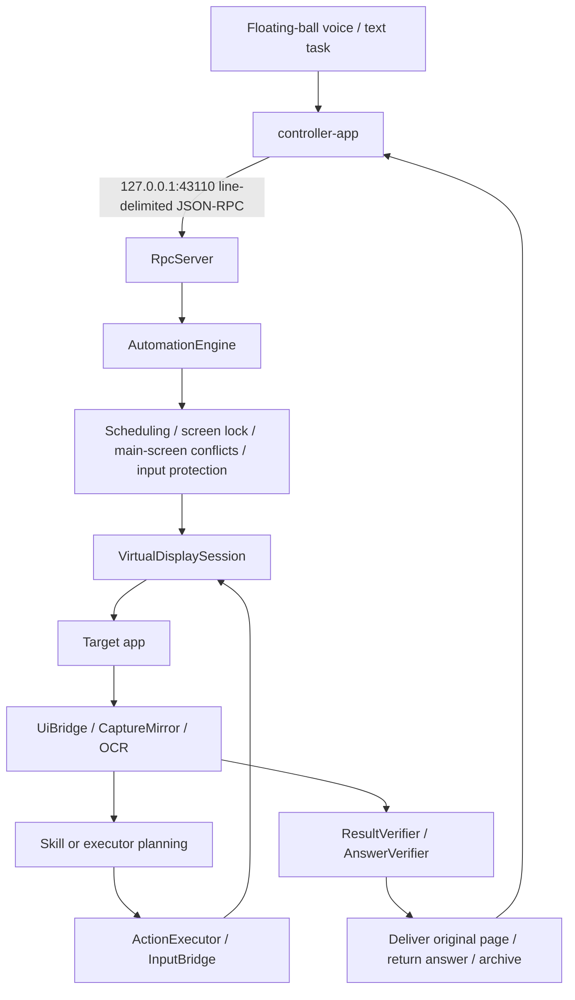

# Technical Documentation

English | [中文](DEVELOPMENT.zh-CN.md)

This document describes QuietPilot's implementation, key technical tradeoffs, and unresolved issues. For installation and everyday use, see the [user guide](USER_GUIDE.en.md); for test records, see the [evidence index](evidence/README.md).

All physical-device measurements in this document come from a Huawei Mate 40 Pro (NOH-AN01, HarmonyOS 4.2.0.192, API 31).

## 1. Choosing an approach

The goal is to let an agent and a user operate the same phone simultaneously, using the user's own apps and accounts without disturbing the user. The main challenges lie at the system level rather than in the agent loop: Android assumes one person using one display, so rendering location, input injection targets, and observation of an invisible display each require a separate solution.

The project uses virtual displays: it creates a `VirtualDisplay` with shell privileges, launches the target app on it with `am start --display`, reads its UI elements through UiAutomation, and injects input using `InputEvent` objects with a displayId, leaving the main display unaffected.

Alternatives evaluated and rejected:

| Approach | Reason for rejection |
| --- | --- |
| Cloud phone or another device logged into the same account | Not the user's own app instance; WeChat logs out the other device |
| App cloning or a work profile | A separate account instance, not the one the user is currently using |
| Accessibility taps on the main display | Takes over the screen the user is using |
| iPhone | Neither virtual displays nor input injection are available |

Open-source implementations of this approach already exist. [ShadowAuto](https://github.com/android-notes/ShadowAuto) (Apache-2.0) has the closest architecture. This project is derived from its `611e5eb` commit and retains underlying capabilities such as `app_process` startup, virtual displays, input injection, OCR, and H.264 previews. Most of the functionality described below was added by this project. See [derivative changes](DERIVATIVE_CHANGES.md) for attribution by component. The upstream article explaining the approach is preserved in [android-virtual-display-ai-automation.md](android-virtual-display-ai-automation.md).

## 2. Overall architecture



- `android-shell`: a shell process launched through ADB using `app_process`, responsible for all automation logic. Entry points are `Main`, `RpcServer`, and `AutomationEngine`; most added code lives in `com.silentauto.shell.ext`.
- `controller-app`: a regular Android app providing configuration, task pages, previews, the floating ball and status capsule, history, and skill management. It provides the interface only and cannot replace the shell process.
- `android-stubs`: compile-time declarations for hidden APIs. A declaration's presence does not mean the device vendor's system permits the call.
- Both modules use `minSdk=29`, `compileSdk/targetSdk=36`, and Java 17.

### Model roles

| Role | Default | Purpose |
| --- | --- | --- |
| executor | DeepSeek Flash | Step-by-step planning, skill matching, and compilation. This role makes the most calls and needs low cost and reliable tool calling |
| verifier | `qwen3-vl-plus` | Result verification, independent query answer extraction, and visual planning for WeChat |
| intake | `qwen3.8-omni-flash` | Speech recognition, reference resolution, and classification as a new task or amendment in a single call |

Execution and verification deliberately use different providers to avoid having a model judge its own results. Separating the roles does not add user-perceived latency: after releasing the floating ball, the user waits for just one intake call. Most time is spent on execution steps, which skill learning is intended to reduce. Only `api.deepseek.com` and `dashscope.aliyuncs.com` are allowed as remote endpoints, with no routing through overseas relays.

## 3. Task lifecycle

A task broadly follows: parse the goal → select an app and match a skill → scheduler admission → create a virtual display → observe–act loop → verify or wait for the user → deliver and clean up → archive.

**Scheduling.** `TaskScheduler` allows at most two active slots and serializes tasks using the same app. `forceStart` can skip waiting for the user to leave that app, but cannot bypass the slot limit or same-app serialization.

**States.**

| State | Meaning |
| --- | --- |
| `QUEUED` | Waiting because slots are full, the same app is in use, or the screen is locked |
| `RUNNING` | Executing |
| `PAUSED` | The user opened the same app on the main display, or the screen is locked |
| `WAITING_USER` | Waiting for the user at a payment/login boundary or after exhausting the step budget |
| `VERIFIED` | An action task passed verification |
| `ANSWERED` / `NOT_FOUND` | A query has an answer / the answer could not be found |
| `FAILED` / `CANCELLED` / `HANDOFF_TIMEOUT` | Failed / cancelled / handoff timed out |

Stopping before payment in `WAITING_USER` is correct boundary handling, but does not mean an order was successfully placed. Reaching a terminal state and completing archival happen at different times; wait for `finalized=true` before reading final screenshots and metrics.

**Each iteration of the main loop:**

1. Check stop requests, screen lock, same-app conflicts on the main display, main-display focus, and pending amendments.
2. Read the virtual display's UI tree and check its usability.
3. Execute a matching skill if available; otherwise ask the executor to plan.
4. Before execution, check read-only constraints, target identity, and input policy.
5. Execute one action, wait for the interface to change, then observe again and record the trajectory.
6. Hand off at a human boundary, verify a completion claim, or independently extract a reported answer.

The step limit is 25.

## 4. Observation and execution

### Handling unreadable UI elements

On physical devices, an app may look normal while its UI tree is empty. `UiBridge` distinguishes between no window, an unreadable root, incomplete traversal, and a lone placeholder root that is invisible, has zero dimensions, and has no children. Real leaf nodes are not mistaken for placeholder roots, and system or input-method windows do not conceal an empty app root.

`UiRecoveryBudget` applies recovery in order: wait twice → clear the cache and reconnect accessibility → for query tasks only, restart the app on the virtual display after confirming it is not on the main display → hand off to the user. Action tasks do not restart the app, because doing so could lose work already completed.

### Discarding stale plans

Planning takes several seconds, during which the interface may change, accessibility may reconnect, or the user may amend the task. Each plan records the connection generation, conflict epoch, and goal version. If any has changed before execution, the plan is discarded and the system observes again.

`ObservedTarget` stores the observed target element's path, class name, ID, text, and bounds, then rechecks it against the current tree before execution. `NodeWritePolicy` verifies that the node being written to belongs to the target window and package. Node numbers and coordinates are valid only for the observation that produced them.

Some Amap and Meituan nodes do not respond even when `performAction(CLICK)` returns success. In those cases, the system locates the node again and performs a touch within its bounds.

### Repeated actions

For “Clear first, then calculate 12×13,” the old version repeatedly cleared the result after obtaining 156, eventually failing after exhausting all 25 steps. `LoopDetector` checks the most recent 6 observations: it detects repetition when the same (screen fingerprint, action, target) occurs 3 times, or when the interface alternates between two states in an ABAB pattern.

On the first trigger, the executor is told it is repeating actions and asked to check whether the goal is already complete. On the second trigger, the executor is no longer called; instead, the verification model judges the current interface directly. If it satisfies the goal, the task finishes normally; otherwise it fails. Skill playback is excluded from detection, and an amendment clears the detection window.

After this change, the task reached `ANSWERED 156` in 7 steps. Another run failed after 16 steps because independent verification failed to recognize the result on the second trigger; that sample is also retained.

## 5. Screen capture: layer-stack mirroring

Upstream captures screenshots by temporarily switching the virtual display's output surface from the video encoder to an `ImageReader`, then switching back. On the Mate 40 Pro, this disturbs the target app: UI elements often become unreadable afterward, and Amap once encountered an ANR.

`CaptureMirror` leaves the original output surface unchanged. It mirrors the virtual display's layer stack to a separate non-secure compositing display, while a dedicated thread continuously drains the mirror's `ImageReader`; a screenshot uses the latest frame. It falls back to the old method only if the mirror cannot be created. The fallback capture mode is recorded in diagnostics and counted separately from the normal path.

Twenty rounds of “capture, then read UI elements” were performed on each of Calculator, a public Meituan page, and Amap's home page: 60/60 succeeded, with `surfaceSwitches=0`.

## 6. Input and focus isolation

This is the project's most difficult and most device-constrained area.

### System capabilities of the test device

| Check | Result |
| --- | --- |
| `config_perDisplayFocusEnabled` | `false`; per-display focus is not enabled |
| `VIRTUAL_DISPLAY_FLAG_OWN_FOCUS` / `STEAL_TOP_FOCUS_DISABLED` | Fields not found through reflection; unavailable in the framework |
| Shell permission `ADD_TRUSTED_DISPLAY` | Not granted; creation candidates using trusted flags throw `SecurityException` |
| `setDisplayImePolicy(LOCAL)` | Rejected for untrusted virtual displays; readback remains fallback |
| `MotionEvent` flag `FLAG_NO_FOCUS_CHANGE` (64) | Effective: ordinary touches move focus to the secondary display; touches with this flag do not |

The final flags are 331 (0x14b). AOSP 12's `DisplayManager` lacks the two independent-focus flags above; they became available in Android 15, and `OWN_FOCUS` also requires a trusted display. This is therefore not a Huawei-specific limitation: the API 31 generation itself does not expose this capability to an ordinary shell. Virtual display creation logs the SDK version, the success or failure of each candidate flag set, the final flags, and both the result and readback of the IME policy setting. See [ISOLATION.md](ISOLATION.md) for detailed boundaries.

By default, the system checks these capabilities at startup and disallows background tasks if they are insufficient. The Mate 40 Pro requires the explicit option `--allow-unverified-isolation=true`; task status and history always carry `experimental_unverified` and `behaviorValidated=false`.

### Workarounds

- **Touch:** all secondary-display touches use `FLAG_NO_FOCUS_CHANGE`.
- **Text input:** prefer accessibility `ACTION_SET_TEXT`, without opening the keyboard. Tests on a standard `EditText` show that setting text directly without first invoking `ACTION_FOCUS` keeps the target window's `windowFocus` false and preserves main-display focus.
- **Keys:** when isolation is unconfirmed, `BackgroundKeyPolicy` blocks keys such as Enter and Paste. Search preferentially taps a search button, while `SubmitTargetPolicy` excludes incorrect targets such as microphone and camera icons.
- **Clipboard:** when clipboard use is necessary, `ClipboardGuard` saves the user's complete `ClipData`, restores it in `finally`, and serializes access with a global lock.
- **Fallback protection:** if `BackgroundFocusGuard` detects an unexpected transfer of main-display focus, it latches the condition and pauses the task. Later normal samples do not automatically resume it.

### Why key injection steals focus

Giving a `KeyEvent` a displayId sends characters to the correct background display, but the main display loses focus at the same time. The cause is AOSP 12's `PhoneWindowManager.interceptKeyBeforeQueueing`: when per-display focus is disabled, a key targeting a display other than the currently focused one triggers `moveDisplayToTop(displayId)`. Touch can avoid this with `NO_FOCUS_CHANGE`; keys have no corresponding mechanism.

A temporary test app, with one Activity on each display recording only its own text and focus, was used to compare input methods:

| Method | Result |
| --- | --- |
| Touch with `NO_FOCUS_CHANGE` | Main-display focus preserved, but no input connection established |
| Direct string input through `ACTION_MULTIPLE` | Returns false; no text arrives |
| Targeted ASCII keys | Background receives characters; main display loses focus |
| Targeted `KEYCODE_PASTE` | Background receives pasted text; main display loses focus |
| Direct `ACTION_SET_TEXT` | Background receives text; main-display focus unchanged |

Other approaches were also investigated: `pm grant` cannot grant signature permissions; Shizuku in ADB mode still runs as shell; modifying global resources requires root; a custom input method cannot obtain the target input connection because Android 12 checks client focus on the server side; reflection cannot access Views in other processes.

Conclusion: input can avoid stealing focus when the target app exposes writable nodes; otherwise, focus must be borrowed.

### Parallel-use measurements

During testing, the user continuously typed Pinyin and occasionally scrolled in Huawei Notes on the main display, while a background Amap task also required text input. The foreground app, `mCurrentFocus`/`mTopFocusedDisplay`, input-method target, and clipboard digest were sampled every 500ms. Three rounds lasted 146, 165, and 193 seconds:

| Round | Samples | Foreground / focus / IME / clipboard disturbances | Maximum sampling interval |
| --- | --- | --- | --- |
| 1 | 292 | 0 / 0 / 0 / 0 | 1277ms |
| 2 | 330 | 0 / 0 / 0 / 0 | 818ms |
| 3 | 387 | 0 / 0 / 0 / 0 | 676ms |

The user reported normal typing and scrolling in all three rounds, with no unexpected disappearance of candidate suggestions. However, the background task itself failed once and required human intervention twice because UI elements were unreadable. Sampling every 500ms also cannot capture very brief events between samples, so `behaviorValidated` remains false. See [evidence/isolation](evidence/isolation/report.md) for the report and raw timelines; results can be recomputed with `node scripts/isolation-report.mjs`.

<a id="12-微信视觉兼容与焦点边界"></a>

## 7. WeChat: a visual fallback

WeChat is the most difficult app to support. On the test device, its accessibility tree contains only a placeholder root (`class=null`, no children, no editable nodes). Enabling `DONT_SUPPRESS_ACCESSIBILITY_SERVICES` produces the same result, so the accessibility text-write approach in Section 6 cannot be used.

Two underlying problems were fixed first. The first was display configuration: the previous implementation mixed the logical resolution of 1152×2376 with the physical density of 560 dpi, causing WeChat to `EXIT_SELF` immediately after launch. `DisplaySpec` now reads `getRealMetrics` from the same logical display, whose actual density is 480; launch became stable after this fix. The second was placeholder-root detection, addressed by the `UiBridge` changes in Section 4.

### Screenshot-based interaction

If the app root remains unreadable after reconnection, `AutomationEngine` runs local PaddleOCR on the same screenshot frame to produce a visual observation, then asks the verifier role's vision model to plan. These calls are counted separately as `visual_planner`, and their step source is `vision_ocr`.

- Unique, high-confidence OCR text takes precedence over model-estimated coordinates.
- Model coordinates normalized to 0–1000 must pass bounds checks after conversion.
- Before tapping text, the system captures another screenshot and locates it again to handle reordered conversation lists.
- Long-press menu text is small and prone to OCR errors. Low-confidence regions are enlarged 2× and recognized again. The result must still be an exact, unique match with confidence ≥ 0.85; otherwise the operation stops rather than guessing coordinates.

Visual steps are not compiled into skills, because skills depend on semantic nodes.

### Borrowing focus

WeChat's input field can acquire focus only through an ordinary touch, after which text is inserted using the visible “Select all / Paste” menu. `InputFocusTransaction` encapsulates this process:

1. Before starting, require focus to be on the main display (display 0) and the current main-display task to be identifiable.
2. Acquire virtual-display focus through touch, check task ownership, screen lock, and conflicts, and enforce a 10-second deadline.
3. Paste through the menu, protecting the clipboard with a `ClipData` snapshot.
4. On success, failure, or cancellation, return focus to the user's current main-display task and restore the clipboard in `finally`.

Before borrowing focus, `MainInputIdleGuard` must also pass: borrowing is blocked if the main-display keyboard is open, an editable field has focus, there has been a recent touch or key event, or readings are missing. It proceeds only after two continuous seconds of confirmed idle input. This check reads main-display window and editing state in memory only; it does not record body text. If a new main-display event is detected during borrowing, the transaction exits immediately and returns focus. Waiting does not consume steps, and the status capsule displays “Waiting for input to become idle.”

In a comparison test, the main display played a local video without an audio track while WeChat sent a message in the background. The video did not pause during approximately 67 seconds. Three focus-borrowing intervals lasted about 6.1, 6.5, and 4.6 seconds, and focus was returned each time. This mechanism conservatively estimates whether user input is idle; some players react to losing window focus, so an entirely imperceptible experience cannot be guaranteed.

### Exact message checks and duplicate-send prevention

Early model-planned runs produced several errors: truncated message bodies, navigation into an official account with the same name, an old draft mistaken for a new one, and incorrectly recognized identifiers. Critical checks therefore now use deterministic rules:

- `startTask` may carry `exactRecipient` and `exactMessage`. Both must appear verbatim in the task goal, and the message body must contain exactly one numeric identifier at least 10 digits long; otherwise the request is rejected.
- Before sending: confirm the conversation title, retrieve the draft through “Select all → Copy” for exact comparison, then use OCR to confirm that the identifier appears exactly once and is in the bottom draft area.
- Immediately before tapping Send, latch “send attempted.” After that, perform verification only; never send again.
- After sending: long-press the bubble with the unique identifier, copy it, and compare the text exactly. Then have the vision model check the title, the sent bubble on the right, and the presence of any failure indicator.

The formal task `wechat-background-1792986804` ran entirely on the virtual display and reached `VERIFIED` in 4 steps and 58.9 seconds. Text copied from both the draft and the sent bubble matched the original exactly, and Send was tapped only once. The raw focus-change count was 3, corresponding to the three focus-borrowing transactions. `DisturbanceMonitor` attributes these to input transactions but retains the raw count, with `zeroDisturbanceVerified=false`.

More than ten earlier failures are recorded by identifier in the [evidence](evidence/wechat-2026-10-26/). Most of the rules above correspond to one of those failures.

## 8. Verification and queries

### Verifying action tasks

The `finish` tool requires `expected_evidence`, describing the completion evidence that should be visible. After a completion claim, `ResultVerifier` waits 1.5 seconds, reads the UI elements again with OCR supplementation if sparse, and captures a screenshot. It calls the verifier in a fresh conversation, providing only the goal, expected evidence, and current interface. Text such as “Send failed,” “Resend,” or “Network error” always causes rejection. A rejected result feeds the missing evidence back into the execution loop; three rejections cause task failure.

Huawei Notes uses a dedicated `DocumentProof`: it checks the title and full body exactly by resource ID, returns to the list, and reopens the note for another check. This path does not call the verifier, which is why some `VERIFIED` samples have a verifier call count of 0.

### Queries

A query task aims to obtain an answer rather than change state.

- `ReadOnlyGuard` checks actions before execution. It blocks targets whose text or description matches sending, submitting, paying, ordering, deleting, sharing, favoriting, and similar operations, as well as text input into non-search fields, and asks the model to query another way. Amap search fields without identifying labels and Meituan city selection have specific allow rules.
- Only `report_answer {answer, quote}` and `report_not_found {searched}` are provided; `finish` is unavailable. Answers are limited to 60 code points, and `quote` must be a contiguous verbatim excerpt from the interface.
- `AnswerVerifier` first asks the verifier to extract an answer independently without seeing the executor's answer. It then checks that both quotes occur in the current interface text and compares the answers. A disagreement is sent back to the executor for up to two retries; if disagreement remains, the verifier's answer is used and marked `uncertain`.
- If the executor reports that nothing was found, the verifier also performs an independent search first.

The answer appears in the status capsule for 8 seconds. “Copy” and “View source” are performed only after a user tap.

<a id="6-完成验收查询与人工交接"></a>

## 9. Handoff and delivery: moving the original page across displays

The initial design let the user handle a handoff through the controller's virtual-display preview. Physical-device testing revealed two problems: protected pages such as payment screens appeared black in the preview, and verification codes were difficult to handle in the small preview. The design therefore changed to move the task's Activity directly between displays.

**Human handoff** (`HandoffManager`, `ManualTaskTransfer`, `TaskDisplayTransfer`): when the executor calls `request_user`, the system first verifies that a genuine boundary has been reached, then enters `WAITING_USER`. Tapping “Handle it” moves the original task to the main display and pauses automation. After handling the step, the user taps “Return to background”; the system checks the page, moves it back to the virtual display, observes again, and resumes. The user explicitly indicates when they have finished, so the system does not have to infer it.

**Result delivery** (`ResultRetention`, `PageIdentity`): after an action task completes, its page is retained. Tapping “View result” moves the original task, after which `PageIdentity` checks the package, page features, and entity anchors such as a note title. The virtual display is released only after confirming that the main display received the original page. On failure, the system attempts to move it back and verify the rollback. Relaunching the app's home page does not count as delivery.

Issuing a move command does not prove that the move succeeded, so `moved`, rollback status, and `previewAvailable` are independent response fields.

**Step-budget exhaustion:** after all 25 steps are used, `StepBudgetHandoff` performs one read-only boundary check and enters `WAITING_USER` with `budgetExhausted=true`, preserving the original page for the user. It neither assumes completion nor adds steps. The coffee order in the demo video is an example: after step 25 exhausted the budget, the order page was handed off to the main display; no payment was made.

## 10. Skills

### What can be learned

At every step, `TrajectoryRecorder` records the pre-action screen fingerprint, action and parameters (preserving input text verbatim), target element features (text, description, resource ID, class name, sibling index, and parent features; bounds are reference-only), source, and whether the interface changed.

Only verified trajectories with no handoff or amendments are learned. A user completes part of a handed-off task, and amended trajectories may include backtracking, making both unsuitable as learning samples. Before compilation, rules remove observation steps, waits, steps undone by Back, and non-input steps that did not change the interface. A single executor call then compiles the trajectory into a parameterized skill. Structural and parameter-reference checks follow, including a requirement that substituting the example parameters reproduces the original trajectory's inputs.

### Screen recognition

`ScreenFingerprint` consists of a package name and a set of stable text. A Jaccard similarity ≥ 0.6 indicates the same screen. Text stability matters: early versions included timestamps, so “Today 17:05” changing to “17:10” made the screen appear different. Clock and relative-time text, hidden nodes, and list items are now excluded.

### Execution and recovery

`SkillRunner` implements `ActionSource`. Each step first compares fingerprints, then scores candidate nodes by their features in the current UI tree. A match is executed, with actual arguments substituted for `{param}`. A mismatch starts recovery: the model is asked to return to the expected screen and stop, with a limit of 3 steps. If recovery succeeds, the skill resumes; otherwise the skill is abandoned and execution falls back to the model. A skill abandoned 3 consecutive times is marked suspect and excluded from matching. Query skills store only the path used to find an answer; the answer is read and verified anew on every run.

### Measured performance

Because WeChat launch was unstable during testing, the three-stage test used Huawei Notes instead:

| Stage | Steps | Model / skill / recovery | Executor calls | Duration |
| --- | --- | --- | --- | --- |
| Initial exploration | 8 | 8 / 0 / 0 | 10 | 27.7 seconds |
| Reuse with new parameters | 10 | 2 / 5 / 3 | 8 | 49.4 seconds |
| Deliberately introduced deviation | 13 | 6 / 3 / 4 | 14 | 63.3 seconds |

All three runs were `VERIFIED`. The recovery test's action-source sequence was `skill, skill, rescue, skill, rescue, …, model`. Reuse saved two model calls but increased both steps and elapsed time, mainly because the saved note's list item lacked unique semantic features. The skill could not match it and had to enter recovery. The skill mechanism therefore works end to end, but has not yet improved speed. See the [skill report](evidence/skills/report.md).

## 11. Voice, main-screen context, and amendments

**Floating ball** (`FloatingBallService`): 64dp in diameter, kept 28dp from screen edges and clear of system gesture areas to reduce accidental touches on curved screens. After a one-second hold, it first reads main-screen context, then requests temporary audio focus, pausing video or music playback to avoid speaker audio interfering with recognition. A short vibration indicates that recording is ready. Sliding up 80dp cancels; recording is limited to 30 seconds. The window matches the ball's dimensions and uses `FLAG_NOT_FOCUSABLE`, allowing touches outside the ball to pass through.

**Status capsule:** Huawei's Live Window on HarmonyOS 4 is available only to partner apps, so this project draws its own capsule below the status bar and clear of the camera cutout. The implementation is abstracted behind `StatusSurface` to support future integration with vendor-native capabilities.

**Main-screen context** (`ScreenContextReader`): read once when the floating ball is pressed, including the UI tree and a screenshot, with OCR added when text is sparse. Status-bar, navigation-bar, and this app's overlay content are filtered out, and password nodes are masked. Context expires after 120 seconds, can be discarded manually, and can be disabled entirely. It is not written to trajectories or included in skills.

Main-screen capture uses the dedicated `UiBridge.MODE_CONTEXT`, reading only text, visibility, bounds, and information needed for privacy masking. This avoids recursively calculating action labels for every node. During traversal, it checks budgets of 1000 nodes, a path-string length of 180, and 6000ms. An unreadable child, unavailable root, or exceeded budget aborts capture and asks the user to let the page settle before retrying. Partial results are not used, and this mode does not automatically clear the cache and retry. Password-node children are not traversed. The 6000ms limit is checked during node traversal; it is not a hard timeout for the entire capture request.

The floating ball includes the current privacy setting as the optional `screenReading` parameter in `captureContext`. Within the same synchronized capture call, the backend applies the setting before deciding whether to read the screen, eliminating a separate RPC. Calls that omit the parameter retain the saved setting. Logs record total capture time; traversal failures also record the node count, elapsed time, and exception type. These statements describe code behavior and do not establish new physical-device performance or privacy validation results.

**Intake** (`VoiceIntake`, `VoiceRouting`): a single Omni call receives the recording, main-screen screenshot and text, installed apps, skill list, and active tasks. It returns a task type (action / query / amendment) and a self-contained task description. High-confidence action tasks start automatically after a three-second cancellation window; low-confidence tasks require user confirmation.

**Amendments** (`AmendmentQueue`): supports modify / add / cancel. Amendments are queued and applied after the current action finishes and before the next step begins; they do not interrupt an action being injected. The effective goal combines the original goal, amendment, and handling rules: amendments take precedence in conflicts, and already-sent messages or submitted orders are not automatically compensated for. Subsequent planning, expected evidence, and verification all use the effective goal. An amendment during skill execution abandons the skill; an amendment during `WAITING_USER` exits the waiting state and resumes modification.

## 12. Screen lock

When the Mate 40 Pro locks, SystemUI overlays a clock on the virtual display and the target Activity enters the STOPPED state. Holding `PARTIAL_WAKE_LOCK` does not prevent this; the system has no `ALWAYS_UNLOCKED` flag, and an independent display group requires trusted privileges. Execution therefore cannot continue while locked; it must pause and resume after unlocking.

`DeviceLockState` detects locking with `!isInteractive() || isKeyguardLocked()`. While locked, new tasks queue without taking a slot or launching an app, and running tasks become `PAUSED` while retaining their virtual display. The input gate checks lock state directly rather than relying on the next periodic sample. Input interrupted by locking does not consume a step; after unlocking, old plans are discarded and the system observes again.

In testing, a Calculator task was locked at step 5. Three checks over 68 seconds all showed it still at step 5, with no additional executor calls. After unlocking, the same task reached `ANSWERED 579` at step 8. See the [screen-lock report](evidence/screen-lock/report.md).

## 13. RPC, storage, and security

The shell process listens on `127.0.0.1:43110` using line-delimited JSON-RPC, not HTTP. Main methods:

| Category | Methods |
| --- | --- |
| Tasks | `ping` `status` `startTask` `stopTask` `listTasks` `getTask` `forceStart` |
| Voice / context / amendments | `submitVoiceTask` `confirmTask` `resolveVoice` `captureContext` `discardContext` `setContextReading` `amendTask` |
| Handoff / delivery | `takeManualOnMain` `resumeTask` `takeResultOnMain` `openTaskOnMain` `injectTouch` `openQuerySource` |
| History / skills | `listHistory` `listSkills` `setSkillStatus` `deleteSkill` |

Fixed connection issues include a loopback self-connection in the controller, now prevented by binding the source port; an old reader thread clearing a newer connection when it exited; and a single slow client blocking event delivery for all tasks. Each client now has a send queue with capacity 64 and is disconnected if it fills. Mutating requests are not automatically replayed after a write failure.

Storage: model configuration is kept in the controller's private SharedPreferences. Skills, trajectories, history, screenshots, and context are stored under `/data/local/tmp/shadowauto/`; reinstalling the controller does not remove these files.

Two security gaps remain. First, RPC has no authentication: any program on the same phone can connect and submit tasks, effectively gaining the ability to operate the user's apps. The planned solution is for the shell to generate a random token at startup, pass it to the controller, and validate it for every method except `ping`. Second, API keys are not encrypted using Keystore.

## 14. Tests and evidence

```sh
./gradlew :android-shell:assembleDebug :controller-app:assembleDebug \
          :android-shell:lintDebug :controller-app:lintDebug
./scripts/test-interaction-regressions.sh
```

The regression script runs eleven groups of Java checks on the host: connections, UI recovery, interaction protection, task transfer, queries, RPC output, screen lock, visual input, main-input idle detection, step-budget handoff, and repetition detection. There are also JS tests for `isolation-report` and Python tests for recording scripts. Host tests cannot establish whether a device accepts hidden APIs, so two device probes are provided: `CaptureMirrorDeviceRegression` and `TouchFlagsDeviceRegression`.

Recording uses `scripts/record-demo.sh`: it first records the main display, watches logs for `VIRTUAL_DISPLAY_READY taskId=… displayId=…`, and automatically starts a second `scrcpy --display-id` recording for that virtual display. The two streams use separate forward ports; with the default reverse mode, concurrent recording causes the main-display connection to fail. On the test device, scrcpy stalls instead of exiting when a virtual display is destroyed, so the script checks displays once per second and stops that recording after two consecutive checks find the display absent.

Evidence is stored in `docs/evidence/`. All files are sanitized copies with keys, phone numbers, contacts, address details below street number, and local machine paths removed. `provenance.json` records hashes of originals and sanitized copies. Original records are kept outside the repository and are not included in Git.

## 15. Future work

| Priority | Item |
| --- | --- |
| P1 | Cover more WeChat entry points and contacts, and validate stability across repeated tests |
| P1 | Transfer complete shop addresses from main-screen context, checking each stage from source page through intake to message body |
| P1 | Record the complete coffee flow continuously on both displays: voice, amendment, option confirmation, and pre-payment handoff |
| P1 | Revalidate isolation with three more rounds of parallel Pinyin input and frame-by-frame checks of candidate suggestions |
| P2 | RPC token authentication |
| P2 | Skills: expand samples and reduce recovery and fallback rates so reuse actually improves speed |
| P2 | Screen lock: cover locking during model requests, long standby periods, and the waiting-for-user state |
| P2 | Other devices and system versions, long-running execution, and resource cleanup |

In the long term, truly independent focus and a local input method on everyday users' phones require system-signature-level privileges and cooperation with phone manufacturers. With those capabilities, most workarounds in Sections 6 and 7 could be removed.
