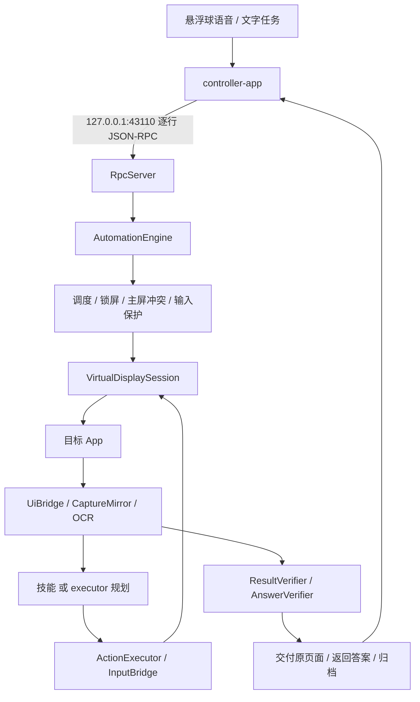

# 技术文档

[English](DEVELOPMENT.md) | 中文

本文档介绍 QuietPilot 的实现方式、主要技术取舍以及尚未解决的问题。安装与日常使用见[使用手册](USER_GUIDE.zh-CN.md)，测试记录见[证据索引](evidence/README.md)。

文中真机数据均来自华为 Mate 40 Pro（NOH-AN01，HarmonyOS 4.2.0.192，API 31）。

## 1. 路线选择

本项目的目标是让 agent 与用户同时使用同一台手机，操作用户自己的 App 和账号，且不干扰用户。主要难点不在 agent 循环，而在系统层面：Android 默认假设一人对应一块屏幕，画面渲染位置、输入注入目标以及如何观察一块不可见的屏幕，都需要单独解决。

本项目采用虚拟屏方案：以 shell 权限创建 `VirtualDisplay`，通过 `am start --display` 将目标 App 启动到虚拟屏上，使用 UiAutomation 读取该屏控件，并通过带 displayId 的 `InputEvent` 向该屏注入输入，主屏不受影响。

评估后放弃的方案：

| 方案 | 放弃原因 |
| --- | --- |
| 云手机、另一台设备登录同账号 | 不是用户自己的 App 实例；微信会把另一端踢下线 |
| 应用分身、工作资料 | 是另一个账号实例，不是用户正在用的那个 |
| 主屏上用无障碍点击 | 直接占用用户正在使用的屏幕 |
| iPhone | 没有虚拟屏，也没有输入注入 |

该路线已有开源实现，其中 [ShadowAuto](https://github.com/android-notes/ShadowAuto)（Apache-2.0）的架构最为接近。本项目基于其 `611e5eb` 提交进行二次开发，沿用 `app_process` 启动、虚拟屏、输入注入、OCR 和 H.264 预览等底层能力，下文介绍的大部分内容为本项目新增。逐项归属见[二次开发说明](DERIVATIVE_CHANGES.md)。上游原理文章保留在 [android-virtual-display-ai-automation.md](android-virtual-display-ai-automation.md)。

## 2. 整体结构



- `android-shell`：通过 ADB 以 `app_process` 启动的 shell 进程，承担全部自动化逻辑。入口为 `Main`、`RpcServer`、`AutomationEngine`，新增代码主要位于 `com.silentauto.shell.ext`。
- `controller-app`：普通 Android 应用，负责配置、任务页、预览、悬浮球与状态胶囊、历史和技能管理。它仅提供界面，不能替代 shell 进程。
- `android-stubs`：隐藏接口的编译期声明。声明存在不代表厂商系统允许调用。
- 两个模块 `minSdk=29`，`compileSdk/targetSdk=36`，Java 17。

### 模型分工

| 角色 | 默认 | 用途 |
| --- | --- | --- |
| executor | DeepSeek Flash | 逐步规划、技能匹配与编译。调用次数最多，要求成本低、工具调用稳定 |
| verifier | `qwen3-vl-plus` | 结果验收、查询答案独立提取、微信视觉规划 |
| intake | `qwen3.8-omni-flash` | 一次调用内完成语音识别、指代理解，并判断为新任务或追加 |

验收与执行有意使用不同厂商的模型，避免同一模型评判自己的结果。分角色不会增加用户感知的延迟：用户只需等待松手后的一次 intake 调用，主要耗时在执行步数上，而这正是技能学习要减少的部分。远程地址只放行 `api.deepseek.com` 和 `dashscope.aliyuncs.com`，不经海外转发。

## 3. 任务生命周期

一个任务大致经历：解析目标 → 选 App、匹配技能 → 调度准入 → 建虚拟屏 → 观察-执行循环 → 验收或等人 → 交付、清理 → 归档。

**调度。** `TaskScheduler` 最多两个活动槽位，同一个 App 不重入。`forceStart` 可以跳过「等待用户离开该 App」，但不会突破槽位上限和同 App 串行约束。

**状态。**

| 状态 | 含义 |
| --- | --- |
| `QUEUED` | 排队：槽位满、同 App 冲突或锁屏 |
| `RUNNING` | 执行中 |
| `PAUSED` | 用户在主屏打开了同一个 App，或者锁屏了 |
| `WAITING_USER` | 停在支付、登录等边界，或步数用完，等用户接手 |
| `VERIFIED` | 办事验收通过 |
| `ANSWERED` / `NOT_FOUND` | 查询有答案 / 确实查不到 |
| `FAILED` / `CANCELLED` / `HANDOFF_TIMEOUT` | 失败 / 取消 / 交接超时 |

停在支付前的 `WAITING_USER` 属于正确的边界处理，但不代表下单成功。状态进入终态与归档完成并非同一时刻，读取最终截图和指标需等待 `finalized=true`。

**主循环的每一步：**

1. 检查停止请求、锁屏、主屏同 App 冲突、主屏焦点、待生效的追加
2. 读取虚拟屏控件树并检查其可用性
3. 有匹配技能时按技能执行，否则由 executor 规划
4. 执行前检查只读约束、目标身份、输入策略
5. 执行一个动作，等待界面变化后重新观察并记录轨迹
6. 遇到人工边界则交接，收到完成声明则验收，收到答案则独立提取

步数上限 25。

## 4. 观察与执行

### 控件读取失败的处理

真机上常见 App 正常显示但控件树为空的情况。`UiBridge` 会区分以下几种情形：没有窗口、根节点读不了、遍历不完整、只有一个占位根（不可见、零尺寸、没有子节点）。真实的叶节点不会被误判成占位根，系统窗口和输入法窗口也不会掩盖应用根为空的事实。

恢复由 `UiRecoveryBudget` 按顺序执行：等待两次 → 清缓存并重连无障碍 → 仅查询任务允许在虚拟屏上重启 App（需确认 App 不在主屏）→ 交给用户。办事任务不重启 App，因为重启会丢失已完成的部分操作。

### 过期规划的丢弃

一次规划需要数秒，期间界面可能变化、无障碍连接可能重连、用户也可能追加要求。每次规划都会记录连接代际、冲突 epoch 和目标版本，执行前任一项发生变化，即丢弃本次规划并重新观察。

`ObservedTarget` 保存观察时目标控件的路径、类名、ID、文字和边界，执行前在当前树里重新核对；`NodeWritePolicy` 检查要写入的节点确实属于目标窗口和包名。节点编号和坐标仅在当次观察中有效。

高德和美团的部分节点在 `performAction(CLICK)` 返回成功后界面并无响应，此类情况改为重新定位后按节点边界执行触摸。

### 重复动作

在「先清除再计算 12×13」任务中，旧版本得到 156 后反复执行清除，直至耗尽 25 步失败。`LoopDetector` 检查最近 6 次观察：同一（界面指纹, 动作, 目标）出现 3 次，或界面在两个状态间 ABAB 交替，即判定为重复。

首次触发时，向 executor 反馈当前正在重复操作，要求先判断目标是否已经完成。再次触发时不再调用 executor，而是直接由验收模型判断当前界面：满足目标则正常结束，否则任务失败。技能回放期间不计入，追加要求后清空检测窗口。

改进后该任务 7 步 `ANSWERED 156`。另有一次 16 步失败，原因是再次触发后独立验收未能识别结果，该样本已保留。

## 5. 抓图：图层栈镜像

上游的抓图方式是临时将虚拟屏输出面从视频编码器切换到 `ImageReader`，截图后再切回。在 Mate 40 Pro 上该方式会扰动目标 App，抓图后经常读不到控件，高德还曾出现 ANR。

`CaptureMirror` 不改动原输出面，而是将虚拟屏的图层栈镜像到一块独立的非安全合成显示上，由专用线程持续排空镜像的 `ImageReader`，截图时取最新一帧。仅在镜像无法建立时回退到旧方式，回退时的 capture mode 会写入诊断信息，与正常路径分开统计。

计算器、美团公开页、高德首页各 20 轮「抓图后读控件」，60/60 成功，`surfaceSwitches=0`。

## 6. 输入与焦点隔离

这是本项目难度最高、受设备限制最大的部分。

### 测试设备的系统能力

| 检查 | 结果 |
| --- | --- |
| `config_perDisplayFocusEnabled` | `false`，系统未启用每屏独立焦点 |
| `VIRTUAL_DISPLAY_FLAG_OWN_FOCUS` / `STEAL_TOP_FOCUS_DISABLED` | 反射找不到字段，框架未提供 |
| shell 的 `ADD_TRUSTED_DISPLAY` | 未授予；带 trusted 的创建候选抛出 `SecurityException` |
| `setDisplayImePolicy(LOCAL)` | 对不受信任的虚拟屏被拒，读回仍是 fallback |
| `MotionEvent` 的 `FLAG_NO_FOCUS_CHANGE`（64） | 有效：普通触摸会把焦点切到次屏，带这个 flag 的不会 |

最终使用的 flags 为 331（0x14b）。AOSP 12 的 `DisplayManager` 中没有上述两个独立焦点 flag，Android 15 才提供，且 `OWN_FOCUS` 还要求 trusted。因此这并非华为特有的限制，API 31 这一代系统本身未向普通 shell 开放该能力。创建虚拟屏时会把 SDK 版本、每个候选 flags 的成败、最终 flags、IME 策略的设置结果和读回值都打进日志。详细的边界整理在 [ISOLATION.md](ISOLATION.md)。

系统默认在启动时检查上述能力，不满足时禁止任务在后台运行。Mate 40 Pro 需显式指定 `--allow-unverified-isolation=true`，任务状态和历史中会始终标注 `experimental_unverified` 和 `behaviorValidated=false`。

### 规避措施

- **触摸：** 所有次屏触摸都加 `FLAG_NO_FOCUS_CHANGE`
- **文字输入：** 优先使用无障碍 `ACTION_SET_TEXT`，不唤起键盘。不先执行 `ACTION_FOCUS` 而直接设置文本时，标准 `EditText` 上的测试显示目标窗口 `windowFocus` 始终为 false，主屏焦点保持不变
- **按键：** 隔离未确认时，`BackgroundKeyPolicy` 禁止回车、粘贴等按键；搜索优先点击搜索按钮，并由 `SubmitTargetPolicy` 排除语音、相机图标等误目标
- **剪贴板：** 必须使用剪贴板时，`ClipboardGuard` 先保存用户完整的 `ClipData`，在 `finally` 中恢复，并使用全局锁串行化
- **兜底：** `BackgroundFocusGuard` 检测到主屏焦点被意外转移时锁定并暂停任务，不会因后续采样恢复正常而自动继续

### 按键注入抢占焦点的原因

为 `KeyEvent` 指定 displayId 后，字符能正确落到后台屏，但主屏会同时失去焦点。原因在 AOSP 12 的 `PhoneWindowManager.interceptKeyBeforeQueueing`：每屏独立焦点关闭时，发往非当前焦点屏的按键会触发 `moveDisplayToTop(displayId)`。触摸可以通过 `NO_FOCUS_CHANGE` 规避，按键则没有对应机制。

为此使用一个临时测试 App（主屏和次屏各一个 Activity，仅记录自身的文本和焦点）对各种输入方式进行了对照：

| 方式 | 结果 |
| --- | --- |
| 带 `NO_FOCUS_CHANGE` 的触摸 | 主屏焦点保持，但不会建立输入连接 |
| `ACTION_MULTIPLE` 直接发字符串 | 返回 false，没有文字到达 |
| 定向 ASCII 按键 | 后台收到字符，主屏失焦 |
| 定向 `KEYCODE_PASTE` | 后台收到粘贴，主屏失焦 |
| 直接 `ACTION_SET_TEXT` | 后台收到，主屏焦点不动 |

其他方向也做了核查：`pm grant` 无法授予 signature 权限；ADB 模式的 Shizuku 仍是 shell 身份；修改全局资源需要 root；自定义输入法无法获得目标的输入连接，Android 12 服务端会核对客户端焦点；反射也无法访问其他进程中的 View。

结论：目标 App 暴露可写节点时可以做到不抢占焦点；不暴露时只能借用焦点。

### 并行实测

测试中，主屏在华为备忘录中持续进行拼音输入并穿插滚动，后台同时运行需要输入文字的高德任务，每 500ms 采样一次前台应用、`mCurrentFocus`/`mTopFocusedDisplay`、输入法目标和剪贴板摘要。共进行三轮，时长分别为 146、165、193 秒：

| 轮次 | 样本数 | 前台 / 焦点 / IME / 剪贴板 | 最大采样间隔 |
| --- | --- | --- | --- |
| 1 | 292 | 0 / 0 / 0 / 0 | 1277ms |
| 2 | 330 | 0 / 0 / 0 / 0 | 818ms |
| 3 | 387 | 0 / 0 / 0 / 0 | 676ms |

三轮中用户反馈输入和滚动均正常，候选词未出现异常消失。但三轮的后台任务本身一次失败、两次因控件不可读转为人工，且 500ms 采样无法覆盖两次采样之间的极短事件，因此 `behaviorValidated` 仍保持 false。报告与原始时间线见 [evidence/isolation](evidence/isolation/report.md)，可通过 `node scripts/isolation-report.mjs` 复算。

## 7. 微信：视觉兼容方案

微信是适配难度最高的 App。在测试设备上，微信的无障碍树只有一个占位根（`class=null`，无子节点，无可编辑节点），启用 `DONT_SUPPRESS_ACCESSIBILITY_SERVICES` 后结果相同，因此第 6 节的无障碍文字写入方式无法使用。

首先修复了两个基础问题。一是显示规格：此前混用了逻辑分辨率 1152×2376 与物理密度 560 dpi，导致微信启动后即 `EXIT_SELF`；`DisplaySpec` 改为从同一逻辑显示读取 `getRealMetrics`，实际密度为 480，修复后启动稳定。二是占位根识别，即第 4 节所述的 `UiBridge` 改进。

### 基于截图的操作

重连后应用根仍不可读时，`AutomationEngine` 对同一帧截图运行本地 PaddleOCR 生成视觉观察，交由 verifier 角色的视觉模型规划（单独计为 `visual_planner` 调用，步骤来源为 `vision_ocr`）。

- 唯一且高置信度的 OCR 文字优先于模型估计的坐标
- 模型输出的 0–1000 归一化坐标换算后需通过边界检查
- 点击文字前重新截图定位，以应对会话列表重排
- 长按菜单的文字较小，OCR 容易误识别；低置信度时局部放大两倍重新识别，仍须精确匹配、置信度 ≥ 0.85 且唯一，否则停止操作，不猜测坐标

视觉步骤不编译为技能，因为技能依赖语义节点。

### 焦点借用

微信输入框只能通过普通触摸获得焦点，再通过可见菜单「全选 / 粘贴」写入。这一过程封装在 `InputFocusTransaction` 中：

1. 开始前要求焦点位于主屏（0 号屏），且能识别主屏当前任务
2. 通过触摸获得虚拟屏焦点，检查任务归属、锁屏和冲突状态，期限 10 秒
3. 通过菜单粘贴，剪贴板使用 `ClipData` 快照保护
4. 无论成功、失败或取消，均在 `finally` 中将焦点归还给用户当前的主屏任务，并恢复剪贴板

借用前还需通过 `MainInputIdleGuard` 检查：主屏键盘展开、可编辑框处于焦点、近期有触摸或按键、读数缺失时均不借用，连续确认空闲 2 秒后才放行。该检查仅在内存中读取主屏窗口和编辑状态，不记录正文。借用过程中若检测到主屏新事件，立即退出事务并归还焦点。等待期间不消耗步数，状态胶囊显示「等待输入空闲」。

对照测试中，主屏播放本地无音轨视频，后台发送微信消息：约 67 秒内视频未暂停，三次焦点借用分别约 6.1、6.5、4.6 秒，均已归还。该机制是对用户输入空闲的保守估计，部分播放器会响应窗口失焦，因此不能保证完全无感知。

### 发送内容核对与防重发

早期依赖模型规划时出现过多类错误：正文被截断、误入同名公众号、将旧草稿当作新草稿、编号识别错误等。因此关键检查改由确定性规则完成：

- `startTask` 可携带 `exactRecipient` 和 `exactMessage`，两者必须逐字出现在任务目标中，正文须包含且仅包含一个至少 10 位的数字编号，否则直接拒绝
- 发送前：确认会话标题，通过「全选 → 复制」取出草稿逐字比对，再用 OCR 确认编号仅出现一次且位于底部草稿区
- 点击发送前先锁存「已尝试发送」，此后只做验收，不再重发
- 发送后：对唯一编号气泡长按「复制」并逐字比对；再由视觉模型核对标题、右侧已发送气泡及是否存在失败标记

正式任务 `wechat-background-1792986804` 全程在虚拟屏执行，4 步、58.9 秒 `VERIFIED`，草稿和已发送气泡的复制内容均与原文一致，仅点击发送一次。原始焦点变化 3 次，对应三次焦点借用；`DisturbanceMonitor` 将其归因于输入事务，但原始计数保留，`zeroDisturbanceVerified=false`。

此前十余次失败均按编号记录在[证据](evidence/wechat-2026-10-26/)中，上述规则大多对应其中某次失败。

## 8. 验收与查询

### 办事验收

`finish` 工具要求携带 `expected_evidence`，说明界面上应能看到的完成证据。收到完成声明后，`ResultVerifier` 等待 1.5 秒，重新读取控件（稀疏时补充 OCR）并截图，以全新对话调用 verifier，仅提供目标、期望证据和当前界面进行判断。界面出现「发送失败」「重新发送」「网络错误」等字样时一律判定不通过。不通过时将缺失内容反馈给执行循环，累计三次判定为失败。

华为备忘录使用专门的 `DocumentProof`：按资源 ID 逐字核对标题和完整正文，返回列表后重新打开再次核对。该路径不调用 verifier，因此部分 `VERIFIED` 样本的 verifier 调用数为 0。

### 查询

查询任务的目标是获取答案，而不是改变状态。

- `ReadOnlyGuard` 在动作执行前拦截：目标文字或描述命中发送、提交、支付、下单、删除、分享、收藏等，或向非搜索框输入文字时，均予以拦截，并提示模型换一种方式查询。高德匿名搜索框、美团城市选择有专门的放行规则
- 仅提供 `report_answer {answer, quote}` 和 `report_not_found {searched}` 工具，不提供 `finish`。答案不超过 60 个码点，`quote` 必须是界面上的连续原文
- `AnswerVerifier` 先让 verifier 在不知道执行方答案的情况下独立提取，再检查双方引文均出现在当前界面文本中，最后比对两个答案。不一致时反馈给执行方重试，最多两次；仍不一致则采用 verifier 的答案并标记 `uncertain`
- 执行方报告查不到时，同样先由 verifier 独立查找一次

答案在状态胶囊上显示 8 秒，「复制」和「去看看」均需用户点击后才执行。

## 9. 交接与交付：原页面跨屏移动

最初的设计是在控制端预览中操作虚拟屏完成交接。真机测试发现两个问题：支付页等受保护页面在预览中显示为黑屏；验证码在小尺寸预览上难以操作。因此改为直接将任务的 Activity 在两块屏之间移动。

**人工交接**（`HandoffManager`、`ManualTaskTransfer`、`TaskDisplayTransfer`）：执行方调用 `request_user` 后，系统先验证是否确实到达边界，再进入 `WAITING_USER`。用户点击「去处理」后，原 task 移到主屏，自动操作暂停；处理完成后点击「交回后台」，系统核对页面后移回虚拟屏，重新观察并继续。处理完成的时机由用户明确告知，无需系统推测。

**结果交付**（`ResultRetention`、`PageIdentity`）：办事任务完成后保留页面。用户点击「去查看」后移动原 task，再由 `PageIdentity` 核对包名、页面特征和实体锚点（如笔记标题），确认主屏收到的是原页面后才释放虚拟屏；失败时尝试移回并核验。重新启动 App 首页不视为交付。

移动命令发出不等于移动成功，因此响应中 `moved`、回退状态和 `previewAvailable` 为相互独立的字段。

**步数耗尽**：25 步用完时，`StepBudgetHandoff` 执行一次只读边界检查，然后以 `budgetExhausted=true` 进入 `WAITING_USER`，保留原页面供用户接手，不推定完成，也不增加步数。演示视频中的咖啡订单即属此情况：第 25 步耗尽后订单页移交主屏，未付款。

## 10. 技能

### 学习范围

`TrajectoryRecorder` 每步记录：执行前的界面指纹、动作和参数（输入文字保留原文）、目标控件特征（文字、描述、资源 ID、类名、兄弟序号、父节点特征，边界只作参考）、来源、界面是否变化。

仅学习验收通过、未经交接、无追加的轨迹：交接后的部分由用户完成，追加的轨迹中含有回退，均不适合作为学习样本。编译前先按规则删除观察步骤、等待、被返回键撤销的步骤以及界面无变化的非输入步骤，再通过一次 executor 调用编译为参数化技能，随后进行结构和参数引用检查，要求示例参数代回后与原轨迹输入一致。

### 界面识别

`ScreenFingerprint` 由包名和稳定文本集合组成，Jaccard 相似度 ≥ 0.6 视为同一界面。文本的稳定性很关键：早期版本将时间文字也纳入指纹，「今天 17:05」变为「17:10」后即被判定为不同界面。现在会排除时钟与相对时间、隐藏节点和列表条目。

### 执行与救援

`SkillRunner` 实现 `ActionSource`，每步先比对指纹，再在当前控件树中按特征为候选节点打分，命中后执行，并将 `{param}` 替换为实参。不匹配时进入救援：调用模型并要求其回到预期界面后停止，最多 3 步；恢复成功则继续执行技能，否则放弃技能交由模型处理。同一技能连续放弃 3 次将被标记为 suspect，不再参与匹配。查询技能只保存查找答案的路径，每次都重新读取并验收答案。

### 实测表现

由于测试期间微信启动不稳定，三段测试改用华为备忘录进行：

| 阶段 | 步数 | 模型 / 技能 / 救援 | executor 调用 | 耗时 |
| --- | --- | --- | --- | --- |
| 首次探索 | 8 | 8 / 0 / 0 | 10 | 27.7 秒 |
| 换参数复用 | 10 | 2 / 5 / 3 | 8 | 49.4 秒 |
| 人为制造偏离 | 13 | 6 / 3 / 4 | 14 | 63.3 秒 |

三次均为 `VERIFIED`，救援测试的动作来源序列为 `skill, skill, rescue, skill, rescue, …, model`。复用减少了两次模型调用，但步数和耗时有所增加，主要原因是保存后的笔记列表项缺少唯一的语义特征，技能在该处无法匹配，只能进入救援。因此目前技能机制已跑通，但尚未带来速度提升。详见[技能报告](evidence/skills/report.md)。

## 11. 语音、主屏上下文与追加

**悬浮球**（`FloatingBallService`）：直径 64dp，避开屏幕边缘 28dp 及系统手势区域，以减少曲面屏误触。长按 1 秒后先读取主屏上下文，再申请临时音频焦点（暂停正在播放的视频或音乐，避免外放声音影响识别），录音就绪时短震提示。上滑 80dp 取消，最长 30 秒。窗口大小与悬浮球一致，设置 `FLAG_NOT_FOCUSABLE`，球外触摸穿透。

**状态胶囊**：华为实况窗在 HarmonyOS 4 上仅对合作应用开放，因此采用自绘胶囊，位于状态栏下方并避开摄像头开孔。实现抽象为 `StatusSurface` 接口，便于后续接入各厂商的原生能力。

**主屏上下文**（`ScreenContextReader`）：仅在按下悬浮球时读取一次，包括控件树和截图，文字过少时补充 OCR。过滤状态栏、导航栏和本应用的悬浮窗，并遮蔽密码节点。上下文 120 秒后过期，可手动丢弃，也可整体关闭读取功能。上下文不写入轨迹，也不进入技能。

主屏采集使用专用的 `UiBridge.MODE_CONTEXT`，只读取文字、可见性、边界及隐私遮蔽所需信息，避免为每个节点反复递归计算操作标签。遍历过程中检查 1000 个节点、路径字符串长度 180 和 6000ms 的预算；遇到不可读子节点、不可用根节点或超出预算时终止本次采集，提示停稳页面后重试，不使用部分读取结果，也不在该模式下自动清缓存重试。密码节点不继续遍历子节点。6000ms 是节点遍历中的检查阈值，并非整个采集请求的硬超时。

悬浮球将当前隐私开关作为可选参数 `screenReading` 随 `captureContext` 一起发送，后台在同一同步采集调用中先应用开关，再决定是否读取屏幕，减少一次独立 RPC；未提供参数的调用沿用已保存的设置。日志记录采集总耗时，遍历失败时另记录节点数、耗时和异常类型。以上为代码行为说明，尚未据此新增真机性能或隐私验证结论。

**intake**（`VoiceIntake`、`VoiceRouting`）：一次 Omni 调用的输入包括录音、主屏截图与文字、已安装 App、技能列表和进行中的任务，输出任务类型（办事 / 查询 / 追加）及自包含的任务描述。高置信度的办事任务在 3 秒取消窗口后自动开始，低置信度时必须由用户确认。

**追加**（`AmendmentQueue`）：支持 modify / add / cancel 三类。追加先入队，在当前动作完成、下一步开始前生效，不打断正在注入的动作。生效后的有效目标由原目标、追加要求和处理规则组成：冲突时以追加为准，已发出的消息或已提交的订单不自行补救。后续规划、期望证据和验收均使用有效目标。技能执行中收到追加时放弃技能；处于 `WAITING_USER` 时收到追加则退出等待并继续修改。

## 12. 锁屏

Mate 40 Pro 锁屏后，SystemUI 会在虚拟屏上覆盖时钟画面，目标 Activity 进入 STOPPED 状态。持有 `PARTIAL_WAKE_LOCK` 无法避免；系统不存在 `ALWAYS_UNLOCKED` flag；独立显示组又需要 trusted 权限。因此锁屏期间无法继续操作，只能暂停并在解锁后继续。

`DeviceLockState` 以 `!isInteractive() || isKeyguardLocked()` 判断锁屏状态。锁屏时新任务排队，不占用槽位、不启动 App；运行中的任务转为 `PAUSED` 并保留虚拟屏。输入门禁直接检查锁屏状态，不依赖下一次定时采样。被锁屏打断的输入不消耗步数，解锁后丢弃旧规划并重新观察。

实测中，计算器任务在第 5 步时锁屏，68 秒内三次检查均停留在第 5 步，executor 调用次数未增加；解锁后同一任务在第 8 步 `ANSWERED 579`。见[锁屏报告](evidence/screen-lock/report.md)。

## 13. RPC、存储与安全

shell 进程监听 `127.0.0.1:43110`，协议为逐行 JSON-RPC（非 HTTP）。主要方法：

| 类别 | 方法 |
| --- | --- |
| 任务 | `ping` `status` `startTask` `stopTask` `listTasks` `getTask` `forceStart` |
| 语音 / 上下文 / 追加 | `submitVoiceTask` `confirmTask` `resolveVoice` `captureContext` `discardContext` `setContextReading` `amendTask` |
| 交接 / 交付 | `takeManualOnMain` `resumeTask` `takeResultOnMain` `openTaskOnMain` `injectTouch` `openQuerySource` |
| 历史 / 技能 | `listHistory` `listSkills` `setSkillStatus` `deleteSkill` |

已修复的连接问题包括：控制端出现回环自连接，现通过绑定源端口排除；旧读线程退出时误清理新连接；单个慢客户端阻塞所有任务的事件推送，现为每个客户端分配容量 64 的发送队列，队列满时断开该客户端。修改类请求写入失败后不自动重放。

数据存储：模型配置保存在控制端私有 SharedPreferences；技能、轨迹、历史、截图和上下文位于 `/data/local/tmp/shadowauto/`，重装控制端不会清除这些数据。

安全方面目前存在两个缺口。一是 RPC 尚无鉴权，同一手机上的任何程序都可以连接并下发任务，相当于可以操作用户的 App。计划方案是 shell 启动时生成随机 token 并交给控制端，除 `ping` 外的方法均需校验。二是 API Key 未使用 Keystore 加密。

## 14. 测试与证据

```sh
./gradlew :android-shell:assembleDebug :controller-app:assembleDebug \
          :android-shell:lintDebug :controller-app:lintDebug
./scripts/test-interaction-regressions.sh
```

回归脚本在主机上运行十一组 Java 检查：连接、UI 恢复、交互保护、任务转移、查询、RPC 输出、锁屏、视觉输入、主屏输入空闲、步数耗尽交接、重复检测；另有 `isolation-report` 的 JS 测试和录屏脚本的 Python 测试。主机测试无法证明设备接受隐藏 API，因此另设 `CaptureMirrorDeviceRegression`、`TouchFlagsDeviceRegression` 两个设备探针。

录屏使用 `scripts/record-demo.sh`：先录制主屏，监听日志中的 `VIRTUAL_DISPLAY_READY taskId=… displayId=…`，自动为该虚拟屏启动第二路 `scrcpy --display-id`。两路使用独立的 forward 端口（默认 reverse 模式并发时主屏连接会失败）；测试设备上虚拟屏销毁后 scrcpy 会停滞不退出，因此脚本每秒检查一次显示屏，连续两次不存在时结束该路录制。

证据位于 `docs/evidence/`，均为脱敏副本，已去除密钥、手机号、联系人、门牌以下地址和本机路径。`provenance.json` 记录原件与脱敏件的哈希。原始记录保存在仓库外，不纳入 Git。

## 15. 后续工作

| 优先级 | 事项 |
| --- | --- |
| P1 | 微信覆盖更多入口和联系人，并通过多轮测试验证稳定性 |
| P1 | 边看边办传递完整店铺地址，从来源页、intake 到消息正文逐项核对 |
| P1 | 咖啡流程从语音、追加、规格确认到支付前交接的完整连续双屏录像 |
| P1 | 隔离复验：拼音输入并行三轮重跑，配合录像逐帧核对候选词 |
| P2 | RPC token 鉴权 |
| P2 | 技能：扩大样本，降低救援和回退比例，使复用真正提速 |
| P2 | 锁屏：覆盖模型请求中途锁屏、长时间待机、等待用户状态 |
| P2 | 其他设备和系统版本，长时间运行和资源回收 |

长期来看，要在普通用户手机上获得真正的独立焦点和本地输入法，需要系统签名级权限，即与手机厂商合作。获得这些能力后，第 6、7 节中的大部分规避措施可以移除。
